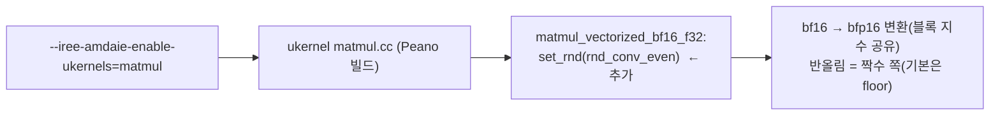

# S10. ukernel bf16 행렬곱 반올림 `rnd_conv_even` (백엔드 ukernel 로컬 수정, **팀 반영 전**)

- 구분: 백엔드 코드(ukernel) 로컬 수정, 우리 변경(2026-10-19 세션 1 챕터 04, 승인 하에). **팀 반영은 백엔드 담당(규민)과 상의**(CLAUDE.md 3-1 방향 변경, 1-3 "10/1 팀 통화")
- 파일: `compiler/plugins/target/AMD-AIE/iree-amd-aie/Target/uKernels/npu4/peano/matmul.cc:188`(O04)
- 이유 문서: `docs/2026-10-19/1_NPU_bf16_벡터화_범위조사/04_U1_반올림_설정_확인/README.md`(원본·patch 포함)

## 1. 흐름상 위치

컴파일 시 ukernel을 켰을 때(`--iree-amdaie-enable-ukernels=matmul --iree-amd-aie-enable-chess-for-ukernel=0`), Peano가 ukernel 소스를 코어 코드로 빌드한다. 그 ukernel 함수 `matmul_vectorized_bf16_f32`의 첫 줄에서 코어의 반올림 모드를 설정한다. **ukernel을 쓰지 않는 경로(VGG f32, 회귀 케이스)에는 영향이 없다.**

## 2. 입력 → 동작 → 출력

- **입력**: bf16 A·B 타일(코어 L1), f32 C
- **동작**: 행렬 MAC 전에 `set_rnd(rnd_conv_even)`로 반올림 모드를 바꾼다. 하드웨어 bfp16 변환(8개 묶음이 지수 공유, 가수 8비트)의 반올림이 기본값 floor에서 **가장 가까운 짝수**로 바뀐다.
- **출력**: 같은 MAC 결과지만 양자화 오차가 줄어든다. 시간은 그대로다.

## 3. 지원 범위와 지원하지 않는 경우

| 경우 | 동작 |
|---|---|
| npu4 Peano ukernel `matmul_vectorized_bf16_f32` | 적용 |
| 다른 ukernel 함수, npu1, chess ukernel | 미적용(이 함수만 고침) |
| ukernel 미사용(기본, VGG f32, 회귀) | 영향 없음 |
| 반올림 모드를 바꾼 뒤 되돌림 | 하지 않는다. 같은 코어의 다음 코드가 이 모드로 돈다(지금은 ukernel 호출만 있어 영향 없음, 추정) |

## 4. 기존 대비 변경점

| | 수정 전 | 수정 후 |
|---|---|---|
| bfp16 변환 반올림 | floor(`crRnd` 기본값, 실행으로 확인) | conv_even |
| 단일 matmul ReLU 흉내 입력 mean_rel | 9.5~13% | **0.94%**(bf16 스칼라 0.23%의 약 4배 = bfp16 본래 정밀도) |
| VGG16 흉내 64장 | top-5 8/64(사용 불가) | top-1 62/64, top-5 56/64, corr ≥ 0.9997 |
| 시간 | — | 같음 |

## 5. 일반성 점검

- 원소 타입 bf16(→bfp16) 전용 함수 안의 설정이다. 함수 자체가 bf16 전용이라 일반성 문제는 아니다.
- 하드웨어 반올림 모드는 코어 전역 상태다. 다른 ukernel이 같은 코어에서 돈다면 모드를 저장·복원해야 할 수 있다(지금은 해당 없음).

## 6. 검증 근거

- numpy 흉내와 비트 단위 일치(블록 최댓값이 올림으로 넘치면 지수 +1 재양자화 포함).
- lit `lower_to_ukernel` 2/2, 회귀 26×2 PASS(회귀는 ukernel을 쓰지 않아 영향 없음).
- 이 작업 트리의 `build-gpu` ukernel은 이 상태로 빌드돼 있다(CLAUDE.md 3-2).
