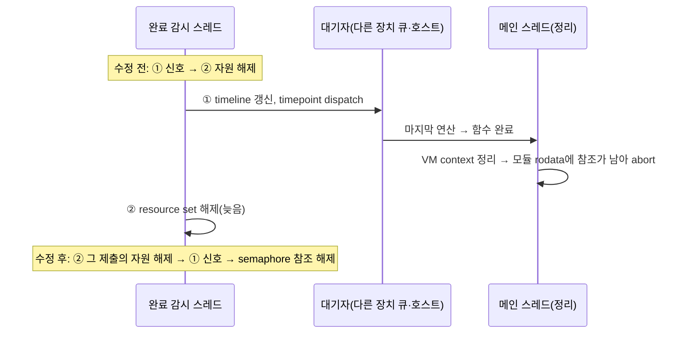

# S11. Vulkan 완료 감시: 제출 자원을 놓은 뒤 신호 (런타임 수정)

- 구분: 런타임 드라이버 수정(IREE 서브모듈 Vulkan HAL), 우리 변경(2026-11-04 세션 1 챕터 03). 수정 대상 코드는 업스트림 코드다(#23695 `completion_watcher.cc`). 커밋: fork `290ecd54b`, 상위 포인터 `6f3b899f`.
- 파일: `third_party/iree/runtime/src/iree/hal/drivers/vulkan/completion_watcher.cc`(동작), `completion_watcher.h`(`register` 주석만). 호출부(`vulkan_device.cc`)는 바꾸지 않았다.
- 이유 문서(로컬 세션 기록, 팀 git 미포함): `docs/2026-11-04/1_정리단계_abort/`. 원인 확정은 챕터 01, 설계는 챕터 02, 구현·검증은 챕터 03.
- 해결하는 문제: 실행은 성공했는데 모듈 정리 중 `iree_vm_buffer_deinitialize`(`runtime/src/iree/vm/buffer.c:79`)가 남은 참조로 abort한다(rc 134). dev CPU+GPU에서 드물게 나고, 링크 표 GPU → CPU true에서 약 0.38%다.

## 1. 흐름상 위치

런타임 Vulkan HAL의 완료 감시 스레드다(`iree-hal-vulkan-…`). `queue_execute`(`vulkan_device.cc` 1921–1959)는 제출한 뒤 Vulkan semaphore 신호 목록과 resource set을 감시에 등록한다(`iree_hal_vulkan_completion_watcher_register`). resource set은 번역된 command buffer를 쥐고, command buffer는 실행 파일과 바인딩 버퍼를 쥔다. 감시 스레드는 `vkWaitSemaphores`로 기다리다가 값이 목표에 닿은 항목을 처리한다(scan).

- 왜 rodata 참조가 남는가: 모듈 상수는 `hal.allocator.import`로 가져온다. 통합 GPU(UMA)에서는 Vulkan이 rodata를 복사 없이 host allocation으로 가져오고, 가져온 HAL 버퍼가 rodata `iree_vm_buffer_t`를 쥔다(`modules/hal/module.c` 466–490). 번역된 command buffer는 바인딩을 보관하므로(컴파일러는 unretained 모드를 쓰지 않음) 감시 항목의 resource set이 상수 버퍼를 쥔다.
- GPU 단독에서는 드러나지 않는다. 함수 완료 fence를 상수를 쥔 제출과 다른 제출(`stream.timepoint.chain_external`)이 신호하고, 감시가 앞 항목을 먼저 처리하기 때문이다. Vulkan 신호를 다른 장치나 호스트가 받아 곧바로 끝나는 다중 장치 실행에서 드러난다.

## 2. 입력 → 동작 → 출력

### 2-1. 등록 (`iree_hal_vulkan_completion_watcher_register`)
- **입력**: 제출 하나가 신호하는 Vulkan semaphore 목록(1개 이상)과 resource set(NULL 가능). resource set의 소유권은 감시로 넘어온다.
- **동작**: 제출마다 묶음(`iree_hal_vulkan_completion_batch_t`: resource set, 항목 수) 하나를 할당한다. semaphore마다 항목을 만들고 모든 항목이 같은 묶음을 가리킨다. 그다음 mutex 아래에서 대기 목록에 넣고 감시를 깨운다.
- **출력**: 성공이면 `OK`다. 묶음 할당 실패, 종료 중, 배열 늘리기 실패면 resource set을 놓고 오류를 돌려준다(헤더 계약대로).

### 2-2. 완료 처리 (scan, 감시 스레드)
- **입력**: 활성 항목의 semaphore 값(`vkGetSemaphoreCounterValue`)
- **동작**: 값이 목표 이상인 항목마다 다음 순서로 처리한다.
  1. 묶음의 resource set이 남아 있으면 놓고 NULL로 둔다. 같은 제출의 다른 항목이 먼저 처리됐다면 이미 NULL이다.
  2. host timeline을 갱신하고 timepoint를 dispatch한다(대기자가 깨어남).
  3. semaphore 참조를 놓는다. 묶음의 마지막 항목이면 묶음도 놓는다.
- **출력**: 대기자가 깨어나는 시점에는 그 semaphore를 신호한 제출의 자원이 이미 놓여 있다.

### 2-3. 실패
- **다른 스레드가 semaphore를 실패시킴**(scan의 실패 분기): 대기자는 이미 깨어났으므로 순서를 바꿀 수 없다. 항목만 놓는다. 자원은 같은 제출의 다른 항목이 완료로 처리될 때, 또는 마지막 항목이 빠질 때 놓는다(수정 전과 같거나 늦다: GPU가 아직 실행 중일 수 있으므로 일찍 놓지 않는다).
- **장치 손실·종료**(`fail_all`): 항목마다 자원 해제 → 실패 알림 → 항목 해제 순서로 한다.

## 3. 지원 범위와 지원하지 않는 경우

| 경우 | 동작 |
|---|---|
| 감시에 등록되는 모든 Vulkan 제출(GPU 단독, CPU+GPU, CPU+NPU+GPU) | 위 순서 |
| 제출 하나가 semaphore 여러 개를 신호 | 어느 항목이 먼저 처리되든 자원을 먼저 놓는다. 전제: 한 제출(vkQueueSubmit 하나)의 signal semaphore는 모두 그 제출이 끝나야 신호된다 |
| semaphore 값이 다른 신호자에 의해 목표 이상이 됨 | 그 제출이 끝났다고 본다(수정 전과 같은 전제, IREE의 timeline 단조 규칙) |
| 남의 semaphore만 신호하는 제출(전임자 BRIDGE L1, S9) | 감시에 등록되지 않는다. 메인 스레드가 fence를 기다린 뒤 직접 놓는다. **이 경로는 바뀌지 않았다**(7절 L-bridge) |
| 감시가 신호하는 순간 이미 끝났지만 아직 처리 안 된 **다른** 제출 | 그 제출의 자원은 감시가 그 항목에 닿을 때 놓인다. 두 제출이 GPU에서 선후 관계면 이번 신호의 대기자가 먼저 끝낼 수 있다(7절 L-cross, 관측된 실패 원인은 아님) |
| 다른 HAL(local-task, HIP, CUDA, amdxdna) | 바꾸지 않음(모두 "신호 → 해제") |

## 4. 기존 대비 변경점

| | 수정 전(업스트림 #23695) | 수정 후 |
|---|---|---|
| 자원 보관 | 마지막 semaphore 항목에만 resource set | 제출마다 묶음 하나를 모든 항목이 공유 |
| 완료 처리 순서 | ① 신호 → ② 그 항목의 resource set 해제 | ② 그 제출의 resource set 해제 → ① 신호 → semaphore 참조 해제 |
| 같은 제출의 앞 semaphore | 신호될 때 자원이 아직 마지막 항목에 남아 있음 | 처음 처리되는 항목이 자원을 놓음 |
| `fail_all` | 실패 알림 → 해제 | 해제 → 실패 알림 |
| 다른 스레드의 실패 | 자원이 붙은 마지막 항목이 빠질 때 놓음 | 같은 제출의 다른 항목 완료 또는 마지막 항목 제거 때 놓음(더 늦거나 같음) |
| 비용 | — | 제출마다 묶음 할당 1회(16 B). 신호가 resource set 해제 시간만큼 늦어짐(측정 6절) |

- **업스트림 새 코드로 바뀔 때**: 업스트림 main은 Vulkan HAL을 다시 쓰면서(`97815d1`, 2026-05-15) `completion_watcher.cc`를 없앴다. 새 `queue.c`의 `iree_hal_vulkan_queue_drain_completions`도 `complete_submission`(신호) 뒤에 `pending_submission_destroy`(해제)를 한다. **fork가 새 드라이버를 들여오면 이 수정은 파일과 함께 사라지고, 같은 abort가 다시 생길 수 있다**(코드 읽기로 판단). 그때는 `drain_completions`에서 해제를 신호 앞으로 다시 옮겨야 한다. 신호 전에 읽어야 하는 자원(타임스탬프 등)은 따로 둔다. 코드 주석(`NOTE(fork)`, scan 완료 분기)에도 적었다.

## 5. 일반성 점검

| 항목 | 의존 | 이유·상태 |
|---|---|---|
| 순서 변경 | 장치·모델·원소 타입 의존 없음 | 모든 Vulkan 제출에 같은 규칙 |
| abort가 드러나는 조건 | rodata를 복사 없이 import하는 장치(통합 GPU/UMA) + 다중 장치 | 수정 자체는 조건과 무관하다. 외장 GPU에서는 import가 복사로 바뀌어 abort가 드러나지 않을 뿐, 순서 규칙은 같다 |
| HAL 계약 | 업스트림 규칙 미정 | "신호가 오면 그 제출의 자원도 놓였다고 봐야 하는가"를 업스트림에 물을 초안이 있다(로컬 `02_설계/upstream_issue_draft.md`, 미제출) |

## 6. 검증 근거

2026-11-04 세션 1 챕터 03. 전원 모드는 모든 측정의 시작·끝이 default다.

| 시험 | 수정 전 | 수정 후 |
|---|---|---|
| 빌드, amd-aie lit, SPIR-V lit, Vulkan CTS | — | 성공(경고 없음), 232/232, 65/65, 12/12(시험별 통과·건너뜀 수 동일) |
| 최소 재현 `y = softmax(x @ W)`(W 상수, matmul은 GPU, softmax는 CPU), 감시 신호 뒤 지연 20 ms 진단 | 50/50 abort | **0/200** |
| dev 조건 GoogLeNet CPU+GPU lead CPU(링크 표 false) | 약 1/1,300 abort, 멈춤 약 0.23% | **3,000회 abort 0**, 멈춤 3(0.10%, 모두 기존 `queue_alloca` 대기 멈춤과 같은 자리) |
| dev 조건 최소 재현 | — | 3,000회 0 |
| 링크 표 GPU → CPU true GoogLeNet(공유 버퍼 브랜치 fork `210f677` + 이 수정) | **8/2,100 abort(0.38%)** | **2,100회 abort 0, 멈춤 0** |
| 회귀 v9 27 × manual·auto / v10 28 × 2(시험 브랜치) | 통과 | 통과 / 통과 |
| VGG16 CPU+NPU+GPU f32 | — | corr 1.00000, top-1 일치 |
| GoogLeNet GPU 단독 | — | 100/100, 지연 진단 200/200 |
| 성능(CPU+GPU, lead CPU, 벽시계 중앙) | GoogLeNet 195 ms, VGG16 357 ms | 181 ms, 366 ms(회차 흔들림 안, 출력 sha 같음) |
| 신호가 늦어지는 시간(감시 scan 한 번의 자원 해제, trace 상한) | — | GoogLeNet 중앙 8 us·최대 0.1–1.6 ms, VGG16 중앙 67–101 us·최대 0.4–0.9 ms |

- 남은 실패: 감시에 지연을 넣는 진단에서 GoogLeNet은 수정 후에도 abort한다(신호 뒤 20 ms 200/200). 원인은 7절 L-bridge다.

## 7. 알려진 한계

| # | 한계 | 확인 | 영향 | 방향(미결정) |
|---|---|---|---|---|
| L-bridge | **BRIDGE 호스트 신호 경로**: 전임자 BRIDGE(`direct_command_queue.cc` 139–184)는 남의 semaphore를 신호하는 제출(예: 함수 끝의 dealloca barrier)에서 호스트가 fence를 기다린 뒤 **감시를 거치지 않고** 바로 신호한다. 그 제출이 GPU에서 기다린 앞 제출 D의 자원은 감시가 D를 처리할 때까지 남는다. 메인 스레드는 이 신호로 함수를 끝내고 정리를 시작한다 | 확인함(진단 로그 2026-11-04 챕터 03 5-4): GoogLeNet CPU+GPU에서 감시 뒤 지연 20 ms를 넣으면 수정 후에도 200/200 abort, 최소 재현은 0/200 | 이 수정만으로는 GoogLeNet 같은 모델의 abort를 다 막지 못한다 | BRIDGE가 호스트에서 신호하기 전에 이미 끝난 감시 항목의 자원을 놓는다(같은 원칙). 수정 범위 확대가 필요해 결정 대기 |
| L-cross | 감시가 한 scan에서 여러 항목을 처리할 때, 이번 신호의 GPU 쪽 선행 제출이 아직 처리 전이면 그 자원이 신호 뒤에 놓인다 | 진단 로그에서 신호 순간 "이미 끝났지만 자원을 쥔 다른 항목"이 흔히 1–5개 | 관측된 실패 원인은 아니다 | scan을 두 단계로(끝난 항목 자원을 모두 먼저 놓고 신호) |
| L-hdr | (해결, 11/05) 헤더 `completion_watcher.h` `register` 주석이 "마지막 semaphore가 목표에 닿을 때 놓는다"였다. 새 동작(목록의 첫 semaphore가 목표에 닿은 것을 볼 때, 어느 신호보다 먼저 놓음)과 "등록 실패 때도 소유권이 감시로 넘어간다"로 고쳤다 | 확인함 | 문서만 | 고침(같은 커밋) |
| L-dfree | `vulkan_device.cc` 1953–1958: `register`가 실패하면 호출부도 resource set을 놓는다. `register`도 실패 경로에서 놓으므로 두 번 놓인다 | 코드 읽기 | 종료 중·메모리 부족 때만 지남(기존 문제, 이번 수정이 더한 묶음 할당 실패 경로도 같은 계약) | 호출부를 헤더 계약에 맞춤(별도) |
| L-up | 업스트림 새 Vulkan 드라이버로 바뀌면 이 수정이 사라진다 | 4절 | 다시 abort | 4절 |
