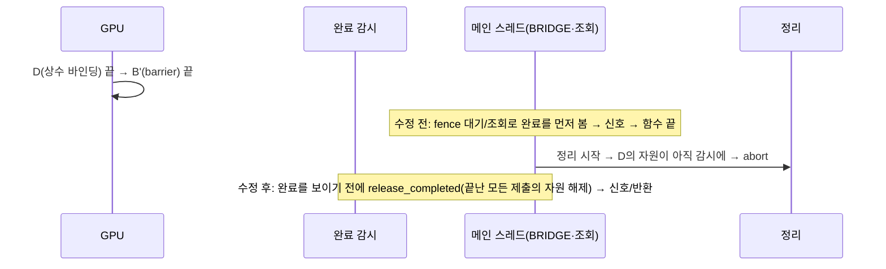

# S11. Vulkan: 완료가 보이기 전에 끝난 제출의 자원을 놓음 (런타임 수정)

- 구분: 런타임 드라이버 수정(IREE 서브모듈 Vulkan HAL). 수정 대상은 업스트림 코드(#23695 `completion_watcher.cc`, `native_semaphore.cc`)와 전임자 BRIDGE L1(`direct_command_queue.cc`, S9)이다.
  - 첫 판(2026-11-04 세션 1 챕터 03, 완료 감시의 신호 순서): fork `290ecd54b`, 상위 포인터 `6f3b899f`.
  - 갱신(2026-11-05 세션 1 챕터 02, 규칙을 넓혀 BRIDGE 경로·semaphore 조회까지, 등록 실패 두 번 해제): fork `9982879c6`(두 번째 길), `370c1236b`(두 번 해제), `302e3a518`(세 번째 길), 상위 포인터 `a6ac34dd`.
- 파일(`third_party/iree/runtime/src/iree/hal/drivers/vulkan/`): `completion_watcher.cc/.h`, `direct_command_queue.cc/.h`, `native_semaphore.cc/.h`, `vulkan_device.cc`.
- 이유 문서(로컬 세션 기록, 팀 git 미포함): `docs/2026-11-04/1_정리단계_abort/`(원인 확정·첫 수정), `docs/2026-11-05/1_BRIDGE경로_링크true_캐시/`(챕터 01 설계, 챕터 02 구현·검증).
- 해결하는 문제: 실행은 성공했는데 모듈 정리 중 `iree_vm_buffer_deinitialize`(`runtime/src/iree/vm/buffer.c:79`)가 남은 참조로 abort한다(rc 134). dev CPU+GPU에서 드물게 나고, 링크 표 GPU → CPU true에서 약 0.38%다.

## 0. 규칙
**완료가 밖으로 보이기 전에(semaphore 신호, 대기자 깨움, 조회 결과 반환), 그때까지 GPU에서 끝난 모든 Vulkan 제출의 자원이 놓여 있다.**
- "그 제출"만이 아니라 "끝난 모든 제출"이어야 한다. 신호한 제출이 GPU에서 기다린 앞 제출의 자원도 같은 이유로 남을 수 있기 때문이다(아래 두 번째 길).
- 이 규칙이 필요한 이유는 다음 사슬이다.
  1. 모듈 상수는 `hal.allocator.import`로 가져온다. 통합 GPU(UMA)에서는 Vulkan이 rodata를 복사 없이 host allocation으로 가져오고, 가져온 HAL 버퍼가 rodata `iree_vm_buffer_t`를 쥔다(`modules/hal/module.c` 466–490).
  2. 번역된 command buffer는 바인딩을 보관한다(컴파일러는 unretained 모드를 쓰지 않음).
  3. 그래서 제출의 자원(resource set)이 상수 버퍼를 쥔다.
  4. 완료를 본 쪽(호스트나 다른 장치 큐)이 곧바로 프로그램을 끝내고 VM context를 정리하면, 아직 남은 자원이 rodata 참조를 쥐고 있어 abort한다.

## 1. 흐름상 위치
런타임 Vulkan HAL에서 "Vulkan 제출의 완료가 호스트에 보이는" 네 곳이다. 모두 같은 함수 `iree_hal_vulkan_completion_watcher_release_completed()`를 먼저 부른다.

| 길 | 위치 | 코드 출처 | 이전 동작 |
|---|---|---|---|
| 첫 번째: 완료 감시의 신호 | `completion_watcher.cc` scan(감시 스레드) | 업스트림 | 신호 뒤 그 항목의 자원 해제(11/04에 "그 제출 해제 → 신호"로 고침) |
| 두 번째: BRIDGE 호스트 신호 | `direct_command_queue.cc` `Submit`: 남의 semaphore를 신호하는 제출에 fence를 붙여 `vkWaitForFences` 뒤 호스트 신호 | 전임자 BRIDGE L1(S9) | 감시를 거치지 않고 바로 신호 |
| 세 번째: semaphore 조회 | `native_semaphore.cc` query: Vulkan 값을 직접 읽고 timepoint dispatch(예: CPU 큐가 작업을 넣으며 기다릴 semaphore를 조회) | 업스트림 | 감시를 거치지 않고 바로 보임 |
| 세 번째: semaphore 호스트 대기 | `native_semaphore.cc` wait: `vkWaitSemaphores` 직접 | 업스트림 | 같음 |

## 2. 입력 → 동작 → 출력

### 2-1. 등록 (`iree_hal_vulkan_completion_watcher_register`, `queue_execute`가 제출 뒤 호출)
- **입력**: 제출 하나가 신호하는 Vulkan semaphore 목록(1개 이상)과 resource set(NULL 가능). resource set의 소유권은 등록이 실패해도 감시로 넘어온다.
- **동작**: 제출마다 묶음(`iree_hal_vulkan_completion_batch_t`) 하나를 할당한다.
  - 묶음에는 resource set, 완료 확인용 (Vulkan semaphore, 목표 값) 하나, 제출 목록 연결, 항목 수가 들어간다.
  - semaphore마다 감시 항목을 만들고, 모든 항목이 같은 묶음을 가리킨다.
  - resource set이 있으면 묶음을 감시 mutex 아래의 **제출 목록**에 넣는다.
- **출력**: 성공이면 `OK`다. 묶음 할당 실패·종료 중·배열 늘리기 실패면 resource set을 놓고 오류를 돌려준다. 호출부(`vulkan_device.cc`)는 이때 다시 놓지 않는다(11/05에 두 번 해제를 고침).

### 2-2. `iree_hal_vulkan_completion_watcher_release_completed(watcher)`
- **입력**: 감시(NULL이면 아무것도 안 함).
- **동작**: 감시 mutex를 잡고, 제출 목록의 각 묶음을 한 번씩 조회한다(`vkGetSemaphoreCounterValue`). 목표에 닿은 묶음은 목록에서 빼고 resource set을 **mutex 안에서** 놓는다. 실패 값(`IREE_HAL_SEMAPHORE_FAILURE_VALUE` 이상)은 "끝남"으로 보지 않는다.
  - 같은 스레드가 해제 경로에서 다시 부르면 바로 돌아간다(스레드별 표시). 바깥 호출이 해제를 끝낸 뒤에야 그 호출자가 진행한다.
- **출력**: 돌아온 시점에, 호출이 시작될 때 끝나 있던 모든 제출의 자원이 놓여 있다. GPU나 감시 스레드를 기다리지 않는다(잠금만).

### 2-3. 완료 감시 scan (감시 스레드)
1. 활성 항목의 값을 모두 읽는다.
2. 하나라도 끝났으면 `release_completed`를 부른다(끝난 모든 제출, 앞선 제출 포함).
3. 1에서 끝난 항목의 host timeline을 갱신하고 timepoint를 dispatch한 뒤 항목을 놓는다.
- 1과 2 사이에 끝난 항목은 자원만 먼저 놓이고 신호는 다음 반복에서 나간다.

### 2-4. BRIDGE 호스트 신호 (`DirectCommandQueue::Submit`)
- fence 대기가 성공하면, 남의 semaphore를 호스트에서 신호하기 **직전에** `release_completed`를 부른다.
- 큐는 장치 생성 끝에 감시를 받는다(`set_completion_watcher`). BRIDGE의 막는 동작(호스트 fence 대기)은 그대로다.

### 2-5. semaphore 조회·대기 (`native_semaphore.cc`)
- 조회: Vulkan 값이 감시가 알린 값(async timeline)보다 크면, 값을 timeline에 반영하고 dispatch하고 돌려주기 전에 `release_completed`를 부른다. 평소(감시가 이미 알린 값)에는 추가 비용이 없다.
- 대기: `vkWaitSemaphores`가 성공하면 조건 없이 먼저 `release_completed`를 부른다(막는 길이라 비용 무관).
- semaphore는 생성 때 장치의 감시를 받아 참조를 쥔다.

### 2-6. 실패·종료
- 다른 스레드가 semaphore를 실패시킨 항목: 대기자는 이미 깨어났으므로 순서를 바꿀 수 없다. 자원은 같은 제출이 끝난 것으로 관찰될 때, 또는 마지막 항목이 빠질 때 놓는다(수정 전보다 이르지 않다. GPU가 아직 실행 중일 수 있으므로).
- 장치 손실·종료(`fail_all`): 목록의 모든 자원을 먼저 놓고 semaphore를 실패시킨다.
- 장치 파괴(`completion_watcher_destroy`): 스레드를 멈추고, 남은 자원을 놓고, 장치의 참조를 놓는다. 감시 메모리는 semaphore 참조가 다 사라질 때 놓인다. 이후 `release_completed`는 목록이 비어 장치에 닿지 않는다.

## 3. 지원 범위와 지원하지 않는 경우
| 경우 | 동작 |
|---|---|
| 감시에 등록되는 모든 Vulkan 제출(GPU 단독, CPU+GPU, CPU+NPU+GPU, lead CPU·GPU) | 위 규칙 |
| 남의 semaphore가 CPU(local-task)·NPU(amdxdna) 어느 쪽이든 | 같은 자리(BRIDGE 호스트 신호 직전)에서 동작 |
| 한 제출이 semaphore 여러 개를 신호 | 첫 semaphore 하나로 완료를 판정(한 vkQueueSubmit의 신호는 함께 옴) |
| semaphore 값이 다른 신호자에 의해 목표 이상이 됨 | 그 제출이 끝났다고 본다(수정 전과 같은 전제, IREE timeline 단조 규칙) |
| 등록 실패(종료 중·메모리 부족) | resource set을 감시가 놓고 오류를 돌려준다. **제출은 이미 나갔으므로 GPU가 실행 중인 command buffer를 놓을 수 있다**(기존 문제, 7절 L-regfail) |
| 다른 HAL(local-task, HIP, CUDA, amdxdna)의 자기 신호 | 바꾸지 않음(모두 "신호 → 해제") |

## 4. 기존 대비 변경점
| | 업스트림(#23695) + 전임자 BRIDGE | 11/04 첫 판 | 11/05 갱신 |
|---|---|---|---|
| 자원 보관 | 마지막 semaphore 항목에만 resource set | 제출마다 묶음(감시 스레드 전용) | 묶음을 감시 mutex 아래 제출 목록에 연결(다른 스레드도 놓을 수 있음) |
| 감시 scan | ① 신호 → ② 그 항목 해제 | 그 제출 해제 → 신호 | 값 관찰 → **끝난 모든 제출** 해제 → 신호 |
| BRIDGE 호스트 신호 | 감시와 무관하게 바로 신호 | 그대로 | 신호 직전에 끝난 모든 제출 해제 |
| semaphore 조회·대기 | Vulkan 값을 바로 보임 | 그대로 | 감시보다 앞선 값이면 먼저 해제 |
| 감시 수명 | 장치와 함께 | 같음 | 참조 수(장치 + semaphore) |
| 등록 실패 | 호출부도 resource set을 놓아 두 번 해제 | 같음 | 호출부는 놓지 않음 |
| 비용 | — | 제출마다 묶음 할당 1회, 신호가 해제 시간만큼 늦어짐 | + BRIDGE 신호마다 제출 목록 조회(목록 1–6개), 조회가 앞선 값을 볼 때만 해제 |

- **업스트림 새 코드로 바뀔 때**:
  - 업스트림 main은 Vulkan HAL을 다시 쓰면서(`97815d1`, 2026-05-15) `completion_watcher.cc`를 없앴다.
  - 새 `queue.c`의 `iree_hal_vulkan_queue_drain_completions`도 `complete_submission`(신호) 뒤에 `pending_submission_destroy`(해제)를 한다.
  - **fork가 새 드라이버를 들여오면 이 수정은 파일과 함께 사라지고, 같은 abort가 다시 생길 수 있다**(코드 읽기로 판단).
  - 그때는 같은 규칙(완료가 보이기 전 끝난 제출 해제)을 새 드라이버의 신호·조회 자리에 다시 넣어야 한다. 신호 전에 읽어야 하는 자원(타임스탬프 등)은 따로 둔다.
  - 코드 주석(`NOTE(fork)`)에도 적었다. 업스트림 이슈는 올리지 않는다(박사형 결정 11/04). 초안은 로컬 참고용이다.

## 5. 일반성 점검
| 항목 | 의존 | 이유·상태 |
|---|---|---|
| 규칙과 적용 자리 | 장치·모델·원소 타입 의존 없음 | 완료가 보이는 모든 자리에 같은 함수 |
| abort가 드러나는 조건 | rodata를 복사 없이 import하는 장치(통합 GPU/UMA) + 다중 장치 | 수정 자체는 조건과 무관하다. 외장 GPU에서는 import가 복사로 바뀌어 abort가 드러나지 않을 뿐, 규칙은 같다 |
| 잠금 순서 | 감시 mutex → (해제 경로의) command pool·transient 버퍼 잠금 | 이 잠금들을 쥔 채 감시 함수를 부르는 코드 없음. 조회를 부르는 쪽(CPU 큐 제출, VM fence, fence 조회, 버퍼 전송, posix proactor)은 잠금을 쥐지 않음 |

## 6. 검증 근거
전원 모드는 모든 측정의 시작·끝이 default다.

### 6-1. 11/04 첫 판 (`docs/2026-11-04/1_정리단계_abort/` 챕터 03)
| 시험 | 수정 전 | 수정 후 |
|---|---|---|
| 최소 재현 `y = softmax(x @ W)`, 감시 신호 뒤 지연 20 ms 진단 | 50/50 abort | 0/200 |
| dev 조건 GoogLeNet CPU+GPU lead CPU | 약 1/1,300 abort, 멈춤 약 0.23% | 3,000회 abort 0, 멈춤 3(0.10%, 기존 `queue_alloca` 대기 멈춤과 같은 자리) |
| 링크 표 GPU → CPU true GoogLeNet(fork `210f677` + 이 수정) | 8/2,100 abort | 2,100회 abort 0 |
| 감시 지연 진단 GoogLeNet | 200/200 | **200/200**(두 번째 길이 남음 → 11/05 갱신) |

### 6-2. 11/05 갱신 (`docs/2026-11-05/1_BRIDGE경로_링크true_캐시/` 챕터 02)
| 시험 | 수정 전 | 수정 후 |
|---|---|---|
| 빌드, amd-aie lit, SPIR-V lit, Vulkan CTS | — | 경고 없음, 232/232, 65/65, 12/12(시험별 수 동일) |
| GoogLeNet lead CPU, 감시 신호 뒤 지연 20 ms / 1 ms / 감시 정지 20 ms | 200/200, 179/200 / — | **0/200**, 0/200 / 0/200 |
| BRIDGE 해제와 신호 사이 지연 20 ms + 감시 정지 | — | 0/100 |
| 세 번째 길 재현: 출력 2개 최소 모델, 감시 정지 50 ms + CPU 큐 제출 지연 5 ms | **50/50 abort** | **0/200** |
| lead GPU·GPU 단독·최소 재현 지연 진단 | — | 모두 0 |
| ASan(GoogLeNet lead CPU·GPU, 최소 재현, 출력 2개 모델 100회) | — | 오류 0 |
| 등록 실패 강제 + ASan | heap-use-after-free(두 번 해제) | 깨끗한 오류 종료, ASan 오류 0 |
| dev 링크 표 GoogLeNet lead CPU 자연 반복 | (11/04) 0/3,000, 멈춤 0.10% | **0/3,000**, 멈춤 5(0.17%, 기준 약 0.1~0.2% 안) |
| 최소 재현 / 출력 2개 모델 / GPU 단독 / GoogLeNet lead GPU 자연 반복 | — | 0/3,000 / 0/1,000 / 0/100 / 0/300 |
| 멈춤 원인 | — | 8건 모두 잠금 교착 아님(감시 스레드는 `vkWaitSemaphores`, worker는 쉬는 중). 7건은 기존 `queue_alloca` 대기, 1건은 BRIDGE 대기 자리(같은 "신호가 오지 않음" 종류) |
| 회귀 v9 27 × manual·auto | 통과 | 통과 |
| VGG16 CPU+NPU+GPU f32 | — | corr 1.00000, top-1 일치 |
| 성능(CPU+GPU, lead CPU, 벽시계 중앙) | GoogLeNet 195 ms, VGG16 385 ms | 205 ms, 374 ms(회차 흔들림 안, trace 실행 시간 같음, 출력 sha 같음) |
| BRIDGE 호스트 신호가 늦어지는 시간(실행마다 1번) | — | 메인 스레드 `release_completed` 15–115 us |

## 7. 알려진 한계
| # | 한계 | 확인 | 영향 | 방향 |
|---|---|---|---|---|
| L-regfail | 등록이 제출 뒤에 있어서, 등록이 실패하면(종료 중·메모리 부족) GPU가 아직 실행 중인 command buffer를 감시가 놓을 수 있다 | 코드 읽기 | 오류 경로에서만 | 실패 때 큐가 빌 때까지 기다리거나 등록을 제출 앞으로(별도) |
| L-leak | dev에 원래 있는 누수: 정리 때 Vulkan 큐 객체 2개(`DirectCommandQueue`, 96 B)가 남는다(ASan LeakSanitizer). dev `32dad76`부터 같음, 이 수정과 무관 | 확인함(ASan) | 종료 때 작은 누수 | 별도 조사 |
| L-up | 업스트림 새 Vulkan 드라이버로 바뀌면 이 수정이 사라진다 | 4절 | 다시 abort | 4절 |
| (해결) L-bridge, L-cross, L-hdr, L-dfree | 11/04 첫 판의 한계(BRIDGE 경로, 제출 사이 순서, 헤더 주석, 두 번 해제) | — | — | 11/05 갱신으로 해결 |
