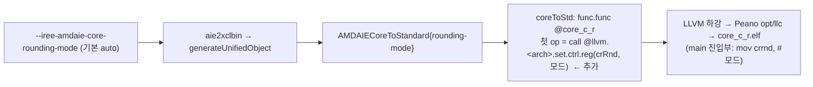

# S11. 코어 반올림 모드(crRnd) 설정 — `amdaie-standard-lowering` `rounding-mode`

- 구분: 수정 Pass(옵션 추가) + 장치 모델 함수 추가 + CLI 옵션.
  - 우리 변경이다(2026-10-22, 세션 `docs/2026-10-21/1_규민브랜치_통합/` 챕터 04, 사용자 승인).
  - 통합 브랜치(`3devices-f32` + 규민 `aie2p-bf16-vectorized`)에 넣는다.
- 파일:
  - `compiler/plugins/target/AMD-AIE/aie/AMDAIECoreToStandard.cpp`
  - `aie/Passes.td`
  - `iree-amd-aie/Target/{XCLBinGen.h,XCLBinGen.cpp,AIETarget.h,AIETarget.cpp}`
  - `runtime/src/iree-amd-aie/aie_runtime/iree_aie_runtime.{h,cc}`
  - lit `aie/test/core_rounding_mode.mlir`(새 파일)
- 이유 문서(로컬 세션 기록):
  - 설계: `docs/2026-10-21/1_규민브랜치_통합/03b_반올림_설계초안/README.md`
  - 구현·시험: 같은 세션 `04_반올림_구현/README.md`
- 관련 명세: S10(ukernel 안 `set_rnd`, 커밋 보류). 이 S11이 들어가면 Peano 경로에서 S10은 중복이다. 그래서 S10은 넣지 않는다(사용자 결정 10/22).

## 1. 흐름상 위치

NPU 코어 코드 생성 단계다. `aie2xclbin` → `generateUnifiedObject`(`XCLBinGen.cpp`)가 `AMDAIECoreToStandard` 패스를 돌린다. 이 패스는 `aie.core`마다 `func.func @core_<col>_<row>`를 만들고, 그 뒤 LLVM 하강을 거쳐 Peano `opt`/`llc`로 코어 ELF를 만든다. 이번 변경은 **코어 함수를 만드는 그 자리**(`coreToStd`)에서 함수 첫 명령을 하나 넣는다.

벡터화·스칼라·ukernel 코어 모두 이 자리를 지나므로 한 번에 적용된다. 런타임·제어 코드·CPU·GPU 코드는 바뀌지 않는다.

## 2. 입력 → 동작 → 출력

- **입력**:
  - `aie.device`(장치 모델: AIE2 `npu1_*` / AIE2P `npu4`), 그 안의 `aie.core`들
  - 패스 옵션 `rounding-mode`(문자열)와 `lower-to-chess`
  - CLI는 `--iree-amdaie-core-rounding-mode=<값>`이다(기본 `auto`). 값은 `AIETarget` 옵션 → `aie2xclbin` → `generateUnifiedObject` → 패스 옵션으로 전달된다.
- **동작**:
  1. 모드를 정한다.
     - `auto`: AIE2P(`isAie2P`)면 `conv_even`, 그 밖에는 넣지 않는다.
     - `none`: 넣지 않는다.
     - 이름: 아래 값 표에서 찾는다. 없으면 오류.
  2. crRnd 번호를 장치 모델 `AMDAIEDeviceModel::getRoundingModeCtrlReg()`에서 얻는다. AIE2는 6, AIE2P는 1이다(Peano `aiev2_defines.h`/`aie2p_defines.h`의 `crRnd`).
  3. 넣을 모드가 있으면 모듈에 `func.func private @llvm.<arch>.set.ctrl.reg(i32, i32)`를 한 번 선언한다(`lockToStd`의 acquire/release 선언과 같은 방식).
  4. 각 코어 함수의 진입 블록 맨 앞에 `arith.constant <crRnd> : i32`, `arith.constant <모드> : i32`, `call @llvm.<arch>.set.ctrl.reg`를 넣는다.
- **출력**:
  - 코어 함수 IR의 첫 명령이 crRnd 설정이 된다. LLVM IR에서 이 호출은 intrinsic `@llvm.aie2p.set.ctrl.reg`가 된다.
  - 최종 ELF에서는 `main` 진입부의 `mov crrnd, #<모드>` 1개다(확인함).
  - 이후 그 코어의 crRnd를 읽는 명령은 모두 이 모드를 따른다: bfp16 변환 `VCONV_bfp16ebs8_fp32`, f32→bf16 `VCONV_bf16_fp32`, 정수 srs `VSRS*`(Peano MIR에서 implicit `$crrnd` 사용).

모드 값(두 arch 공통, `rnd_*`):

| 이름 | floor | ceil | sym_floor | sym_ceil | neg_inf | pos_inf | sym_zero | sym_inf | conv_even | conv_odd |
|---|---|---|---|---|---|---|---|---|---|---|
| 값 | 0 | 1 | 2 | 3 | 8 | 9 | 10 | 11 | 12 | 13 |

## 3. 지원 범위와 지원하지 않는 경우

| 경우 | 동작 |
|---|---|
| AIE2P(npu4), Peano, `auto`(기본) | **모든 코어**에 conv_even(12)을 crRnd(1)에 쓴다 |
| AIE2(npu1), Peano, `auto`(기본) | 넣지 않는다. IR이 수정 전과 같다 |
| `none` | 넣지 않는다(수정 전 동작, 비교·회귀용) |
| 이름을 명시(예: `floor`) | AIE2·AIE2P 모두 그 값을 쓴다(AIE2는 crRnd 6) |
| 모르는 이름 | `aie.device`에 오류 `unknown rounding mode '<x>' (expected …)`, 패스 실패 |
| chess(`lower-to-chess`) | **넣지 않는다**(L2). 이름을 명시했으면 경고 `rounding mode '<x>' is ignored when lowering to chess`, `auto`면 조용히 건너뜀 |
| 장치 모델에 crRnd 번호가 없는 장치(AIE1 등) | 넣을 모드가 있으면 오류 `has no rounding control register; …`. `auto`는 AIE2P에서만 켜지므로 해당 없음 |
| 코어 안에서 모드를 바꾸는 코드(ukernel·헤더 `_conf` 함수) | 막지 않는다. 진입부 설정 뒤에 바꾸면 그 값이 쓰인다 |

## 4. 기존 대비 변경점

| | 수정 전 | 수정 후 |
|---|---|---|
| `amdaie-standard-lowering` 옵션 | `lower-to-chess` | + `rounding-mode`(기본 `auto`) |
| AIE2P 코어 시작 시 crRnd | 아무도 설정하지 않음 → 하드웨어 리셋 값 floor(실행으로 확인) | conv_even |
| AIE2P 벡터화 bf16 matmul(bfp16 변환) | floor. 흉내와 rand 입력 100% 비트 일치 | round-half-even. conv_even 흉내와 rand 입력 100% 비트 일치(4모양). ReLU 흉내 입력 mean_rel 9.5~13% → 0.91% |
| AIE2P 벡터화 int8 matmul | — | 출력 sha256 같음(crRnd 소비자 없음) |
| 벡터화 끈 경로(회귀 26×2, VGG16 2·3장치) | — | 출력 sha256 같음. NPU가 낀 vmfb sha256은 바뀜(코어 명령 1개 추가) |
| AIE2 코어 | — | 기본에서는 IR이 같음(기존 npu1 lit 그대로 통과) |
| 장치 모델 | — | `getRoundingModeCtrlReg()` 추가 |
| `aie2xclbin` 시그니처 | `…, enableCtrlPkt)` | `…, enableCtrlPkt, coreRoundingMode = "auto")`(기존 호출부 그대로 컴파일) |

## 5. 일반성 점검 (1-4의 1)

- 특정 모델·모양·원소 타입 의존이 없다. 코어 단위 전역 설정이다.
- 장치마다 다른 값(crRnd 번호)은 장치 모델 한 곳에 둔다. 모드 값은 두 arch가 같다.
- **AIE2P 기본 conv_even의 근거**:
  - MLIR `arith.truncf`의 정의된 의미가 round-to-nearest-even이다. 하드웨어를 IR 의미에 맞추는 설정이다.
  - floor는 하드웨어 리셋 값일 뿐 의도된 선택이 아니다(10/19 확인).
- **AIE2 기본 "넣지 않음"은 장치 판단이다**:
  - AIE2는 bf16 출력 srs·정수 srs 하강이 있어서 기본을 바꾸면 팀 npu1 결과가 바뀐다.
  - 기존 결과를 지키려고 넣지 않았다. 옵션으로는 켤 수 있다.
- **범위가 모든 AIE2P 코어(S1)인 이유**:
  - bfp16 변환이 코어 어디서 나오든(aievec 하강·ukernel) 같은 상태가 된다.
  - 본문을 검사하지 않아도 된다.

## 6. 알려진 한계

- **L1. 앞으로 AIE2P에 srs·bf16 출력 하강이 생기면 그 결과도 crRnd를 따른다.**
  - 지금 AIE2P에는 `aievec.srs` 하강이 없다(`AIEVecToLLVM.cpp` `SRSOpConversion`의 `assert(isAie2(device))`).
  - 벡터 f32→bf16 출력 변환도 하강되지 않는다. f32 누산 + `truncf` bf16 출력 matmul은 Peano `llc`의 `G_FPTRUNC <64 x s32>` legalize 실패로 컴파일되지 않는다. 반올림 설정과 무관함을 확인했다.
  - 그래서 지금 crRnd를 읽는 것은 bfp16 변환뿐이다.
  - 나중에 그 하강이 들어오면 설정한 conv_even을 따른다.
    - bf16 출력은 `truncf` 의미(RNE)와 맞는다.
    - int8 srs는 floor가 아니라 round-half-even이 된다. 정수 반올림을 무엇으로 할지는 그때 정한다.
    - 연산마다 다른 모드가 필요하면 그 하강이 Peano `_conf` 함수처럼 저장·설정·복원해야 한다.
- **L2. chess 경로는 지원하지 않는다(건너뜀).**
  - chess는 intrinsic 이름 체계가 다르다(AIE2P도 `aie2`). 우리 경로에서 쓰지 않아 확인하지 않았다.
  - chess 코어의 crRnd는 리셋 값이나 chess 런타임이 정한 값을 따른다(미확인).
- 모드는 코어 시작 때 한 번만 쓴다. 되돌리지 않는다(코어 프로그램 끝까지 같은 상태).

## 7. 검증 근거 (2026-10-22, 챕터 04)

- lit:
  - `aie/test/core_rounding_mode.mlir` RUN 6줄이 통과한다(기본 npu4·npu1 / `none` / `floor` npu4·npu1 / chess / chess+명시 경고 / 모르는 이름 오류).
  - aie 방언 lit 58/58(수정 전 57/57).
  - 플러그인 전체 lit은 실패 목록이 수정 전과 같다.
- 코어 코드:
  - npu4 행렬곱 6경우 모두 코어 32개의 첫 명령이 `@llvm.aie2p.set.ctrl.reg(i32 1, i32 12)`이고, Peano opt 뒤에도 그대로다.
  - ELF에는 `mov crrnd, #0xc` 1개가 있다(수정 전 0개).
- NPU 실행:
  - bf16 rand 4모양이 conv_even 흉내와 100% 비트 일치한다.
  - int8 2모양 sha256이 같다.
  - 회귀 26×2 PASS, stdout 52개가 바이트 동일하다.
  - VGG16 2장치 출력 `d5f1ebb9…`, f32 3장치 출력 `e4dcc1a0…`(3회)가 그대로다.
  - 시간은 같다.
