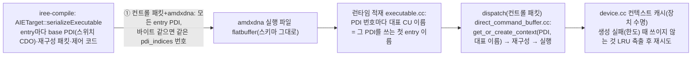

# S13. 컨트롤 패킷 경로 — 배선(base PDI) 묶음별 PDI와 hw context

- 구분: 컴파일러 직렬화 수정(`AIETarget::serializeExecutable`) + 런타임 수정(amdxdna 실행 파일 적재·dispatch·장치 컨텍스트 캐시).
  - 우리 변경이다(2026-10-22, 세션 `docs/2026-10-22/6_B1_컨트롤패킷_PDI묶음/`, 사용자 승인).
  - 통합 브랜치에 넣는다.
- 파일:
  - `compiler/plugins/target/AMD-AIE/iree-amd-aie/Target/AIETarget.cpp`
  - `runtime/src/iree-amd-aie/driver/amdxdna/{executable_internal.h,executable.cc,direct_command_buffer.cc,device.cc}`
- 이유 문서(로컬 세션 기록):
  - 원인·설계 이력: `docs/2026-10-22/5_hwctx_수명_설계조사/`
  - 설계·재현·시험: `docs/2026-10-22/6_B1_컨트롤패킷_PDI묶음/`
- 적용 범위: **컨트롤 패킷(`--iree-amdaie-enable-control-packet=true`, 기본 false) + amdxdna HAL**일 때만 동작이 바뀐다. 기본 경로는 그대로다.

## 1. 배선이 하나라는 기존 가정 (바꾸기 전)
컨트롤 패킷 경로는 "한 실행 파일의 entry point들은 같은 배선(base PDI)을 쓴다"고 가정했다. 세 곳이 이 가정에 기댔다.

| # | 위치 | 기존 동작 |
|---|---|---|
| ① | `AIETarget.cpp` 아티팩트 직렬화 | 컨트롤 패킷이면 첫 entry만 PDI를 넣고 나머지는 빈 문자열(`pdi_indices = -1`) |
| ② | `direct_command_buffer.cc` 컨트롤 패킷 dispatch | PDI 있는 entry가 만든 컨텍스트를 `executable->context` 하나에 두고, 빈 PDI entry가 그 컨텍스트·CU를 그대로 씀 |
| ③ | `AMDAIEConvertDeviceToControlPackets`(기본 `broadcast-core-config=true`, 이번에 바꾸지 않음) | 재구성 패킷에 코어 ELF·init(DMA·잠금)·core enable만 넣고 **스위치(배선) 설정은 뺀다** → 배선은 base PDI에서만 온다 |

- 그런데 entry들의 base PDI는 다를 수 있다. VGG16 bf16 벡터화는 23개 entry가 6종이다.
- **확인한 결과**(바꾸기 전 빌드, 세션 6):
  - 모델 `pa`(3종): 컨트롤 패킷 출력이 틀렸다(float64 대비 corr 0.229, 기준 NPU와 비트 일치 25%).
  - 모델 `pd2`(2종): 우연히 맞았다(바뀐 연결이 행 두 개의 맞바꿈이라 같은 데이터가 흐른 것으로 추정).

## 2. 흐름상 위치

## 3. 입력 → 동작 → 출력
- **컴파일러**
  - 입력: 한 실행 파일의 entry들. 각 entry의 `design.pdi`(컨트롤 패킷이면 스위치 CDO만), 재구성 패킷, 제어 코드.
  - 동작: 컨트롤 패킷 + `DeviceHAL::AMDXDNA`면 모든 entry의 PDI를 읽는다. `Flatbuffer1dStringArrayConverter::addEntryDedup`이 **PDI 바이트 전체가 같으면** 앞 entry의 번호를 준다. 키는 `llvm::StringMap`(전체 바이트), 해시는 찾기용이다.
  - 출력: `pdis` = 서로 다른 base PDI들, `pdi_indices` = entry별 묶음 번호. 스키마는 그대로다.
- **런타임 적재**
  - 입력: `pdi_indices`.
  - 동작: PDI 번호마다 그 번호를 처음 쓰는 entry의 이름을 `kernel_params.context_cu_name`에 넣는다.
- **런타임 dispatch**(컨트롤 패킷 경로, `num_reconfigurations > 0` 이고 PDI 있음)
  - 입력: entry의 PDI, `context_cu_name`.
  - 동작:
    - 장치 캐시에서 (PDI 바이트, 대표 이름)으로 컨텍스트를 찾는다. 없으면 만든다(처음 쓸 때). CU도 대표 이름으로 연다.
    - 같은 묶음의 entry들은 같은 컨텍스트·같은 CU를 쓰고, 다른 묶음은 다른 컨텍스트를 쓴다.
    - CU 이름은 shim 안 이름표다(드라이버로 가지 않음).
  - 출력: 각 entry가 자기 base PDI(배선)의 컨텍스트에서 재구성 → 실행된다.
- **캐시**
  - 장치 수명 동안 쥐고, 장치가 없어질 때 비운다(기존 그대로).
  - 생성이 `NOT_FOUND`·`RESOURCE_EXHAUSTED`·`UNAVAILABLE`(드라이버 `ENOENT`·`ENOSPC`·`EBUSY`: 컨텍스트 한도 등)로 실패하면, 캐시만 쥔(`use_count() == 1`) 컨텍스트 중 가장 오래전에 쓴 것을 없애고(`[T] ctx EVICT` 로그) 다시 만든다.
  - 없앨 것이 없으면 원래 에러에 "no idle cached hw context to evict (n cached)"를 덧붙여 낸다.

## 4. 지원 범위
- 바뀌는 것:
  - 컨트롤 패킷 + amdxdna HAL의 실행 파일.
  - 장치 컨텍스트 캐시의 생성 실패 처리(전임자 opt-in 캐시 `IREE_AMDXDNA_CACHE_HWCTX` 경로도 같은 함수를 쓰므로 같이 적용).
- 바뀌지 않는 것:
  - 컨트롤 패킷이 꺼진 기본 경로(컴파일러 `addEntry`·런타임 일반 dispatch 그대로, VGG16 vmfb sha 동일 확인).
  - XRT HAL(Windows `driver/xrt`)의 직렬화 규칙(첫 entry만 PDI).
  - 옛 vmfb의 빈 PDI(-1) entry: 지금처럼 `executable->context`를 쓴다.
- 지원하지 않는 경우와 동작:
  - 같은 묶음 안에서 PDI 바이트는 같지만 배선이 다른 경우는 없다(바이트가 같으면 배선도 같다).
  - 바이트가 다르지만 배선 의미가 같은 entry는 다른 묶음이 된다(보수적, 컨텍스트가 더 생길 뿐 정확함).

## 5. 기존 대비 변경점(전/후)
| | 전 | 후 |
|---|---|---|
| 컨트롤 패킷 실행 파일의 PDI | 첫 entry 1개 | 서로 다른 base PDI 수(VGG16 6, pd2 2, pa 3, chain4 1) |
| 컨트롤 패킷 dispatch 컨텍스트 | 실행 파일당 1개(첫 entry 배선) | 배선 묶음당 1개(각 entry 자기 배선) |
| 배선이 다른 entry의 결과 | 틀릴 수 있음(`pa` 확인) | 맞음(시험 8절) |
| VGG16 bf16 벡터화 + 컨트롤 패킷(배선 6종) | 첫 entry 배선으로만 실행(실행 안 함, 위험) | 컨텍스트 6회, 출력 sha `6ccb1a0a…`(컨트롤 패킷 끔과 같음), 1회 wall 0.97 s(끔 약 2.8~3.8 s), 같은 프로세스 반복 0.25 s/회 |
| 컨텍스트 생성 실패 | 그대로 에러 | 쓰이지 않는 캐시 컨텍스트 LRU 축출 후 재시도, 그래도 안 되면 정보 붙은 에러 |
| 기본 경로 | — | 변경 없음 |

## 6. 일반성
- 모델·모양과 무관한 규칙이다. PDI 바이트가 같으면 공유하고, 다르면 나눈다.
- 업스트림 설계(`521fa8f5` PDI 키 캐시, `9c9d0d94` 컨트롤 패킷 흐름)를 넓히는 것이다. 업스트림 `521fa8f5` 메시지의 caveat("byte-identical bootstrap PDI … unverified for larger array shapes", "compiler-side assertion … follow-up")를 다룬다.

## 7. 알려진 한계·팀 판단 항목
- **L1 컨텍스트 수**: 묶음 수만큼 컨텍스트가 생긴다(VGG16 6개). 1개로 줄이려면 배선 통일 또는 `broadcast-core-config=false`(재구성 패킷에 배선 포함)가 필요하다. 업스트림 설계 영역이다.
- **L2 프로세스당 상한 없음**: 캐시는 장치 수명 동안 컨텍스트를 쥔다.
  - 장치 한도 32는 모든 사용자 합이라, 한 프로세스가 많이 쥐면 다른 사용자가 컨텍스트를 못 만들 수 있다.
  - 축출은 우리 생성이 실패할 때만 일어나고 다른 사용자를 위해 먼저 내놓지는 않는다.
  - 프로세스당 상한(플래그) 여부는 팀 판단이다(제안만).
- **L3 축출 대상**: `executable->context`도 마지막 PDI 컨텍스트를 쥐므로(`use_count() == 2`) 실행 파일당 마지막으로 쓴 묶음 하나는 축출되지 않는다(보수적).
- **L4 XRT HAL**: 같은 가정(첫 entry만 PDI)이 남아 있다. 이 장비에서 시험할 수 없어 바꾸지 않았다.
- **L5 #1254**: 업스트림 packet flow arbiter deadlock 이슈(#1254)는 열려 있다. `--iree-amdaie-packet-flow-strategy=auto`로 위험을 줄일 뿐이다.

## 8. 시험
- 세션 `docs/2026-10-22/6_B1_컨트롤패킷_PDI묶음/` 04절: 컨트롤 패킷 끔(회귀 quick, VGG16 vmfb·출력 sha)과 켬(pd2·pa·chain4·mm256, VGG16)이다.
- 결과(2026-10-22, npu4, amdxdna 2.23):
  - 끔: VGG16 vmfb `10abd446…`·출력 `6ccb1a0a…` 그대로, 회귀 quick 전부 PASS.
  - 켬:
    - 배선 2종 `pd2` → 컨텍스트 2, 배선 3종 `pa` → 3. 둘 다 끔 출력과 비트 동일(고치기 전 `pa`는 corr 0.229).
    - `chain4` → 1. `mm256`은 흉내 V3.1과 비트 100%.
  - **VGG16 bf16 벡터화**:
    - 컨텍스트 생성 6회(ctx MISS 6, HIT 17), 출력 sha `6ccb1a0a…`(끔과 같음), 멈춤 0.
    - 1회 wall 971 ms(첫 dispatch 전 205, NPU 구간 486, 종료 때 해제 280).
    - 같은 프로세스 5회 반복: 526, 257, 257, 256, 253 ms. 1회당 NPU 계산 139 ms(끔 194 ms), 재구성 7~8 ms.
- lit: 플러그인 lit은 기준선과 같은 실패 목록이다(시험 도구 미빌드, `assign_device_affinities`). 직렬화는 flatbuffer라 lit 대신 vmfb 안 PDI 개수 검사로 확인했다.
