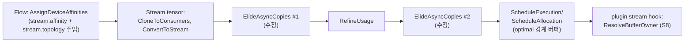

# S1. `ElideAsyncCopies` 양방향 topology 판정 (수정 Pass, IREE 업스트림 파일)

- 구분: **수정 Pass**(업스트림 IREE `Stream` 패스), 우리 변경(2026-09-28 챕터 06, 태그 `3DEV`)
- 파일: `third_party/iree/compiler/src/iree/compiler/Dialect/Stream/Transforms/ElideAsyncCopies.cpp` (장부 I01~I03), lit `…/Stream/Transforms/test/elide_async_copies_topology.mlir` (I04)
- 이유 문서: `docs/2026-09-28/06_ElideAsyncCopies_양방향판정_수정/README.md`

## 1. 흐름상 위치

Stream 단계의 async 파이프라인(`Dialect/Stream/Transforms/Passes.cpp` `buildStreamAsyncPassPipeline`)에서 **두 번** 돈다.
- 1회차 `:257`: `MaterializeCopyOnWrite` 뒤, `EmplaceAllocations` 앞
- 2회차 `:274`: `RefineUsage`가 lifetime을 확정한 뒤

`stream.topology`는 Flow 단계 배정 패스(`AMDAIEAssignDeviceAffinities`, S7)가 모듈에 주입한 것을 읽는다. 결과(남은 `stream.async.transfer`)는 뒤의 `ScheduleAllocation`이 `optimal<[...]>` 경계 버퍼를 만들 때와 `AMDAIEResolveBufferOwner`(S8)가 소유자를 고를 때의 입력이 된다.

## 2. 입력 → 동작 → 출력

- **입력**: `stream.async.transfer %src from(A) -> to(B)`(같은 lifetime의 장치 간 전송), 모듈의 `stream.topology` 표(`(X -> Y) = {unified_memory, transparent_access}`, 방향별).
- **동작**(`isSafeToElideTransferOp` 안 topology 판정, `:1100-1135`):
  1. `unified = U(S,R) || U(R,S)` — unified memory는 **쌍의 성질**로 본다.
  2. `R→S = T(result, source)`, `S→R = T(source, result)` (`T(X,Y)` = X가 Y 메모리를 복사 없이 읽음).
  3. 소스가 **위치 고정**인지 `hasPinnedPlacement(source)`로 본다(`:838-895`). 정의를 거슬러 올라가며 `stream.tensor.import`, `stream.async.constant`, `util.global.load`, lifetime이 `constant`·`variable`인 resource를 만나면 고정. 같은 lifetime의 `async.transfer`·`async.clone`은 소스를 따라간다(제거 순서에 따라 결과가 달라지지 않게). 분석이 끝까지 안 되면(INCOMPLETE) **고정으로 본다**(보수적).
  4. 판정:
     - `unified || R→S` → elide 허용(결과 장치가 소스 메모리를 읽을 수 있다)
     - `S→R && !pinned` → elide 허용(공유 버퍼를 나중에 소스 쪽이 아니라 결과 쪽에 둘 수 있다. 실제 위치는 소유자 결정이 정한다)
     - `S→R && pinned && !R→S` → **elide 금지**(`return false`, 고정 소스를 결과 장치가 못 읽는다)
     - 그 외 → elide 금지(기존과 같음)
  5. topology가 허용해도 다른 이유(보호 복사 등)로 막히는지는 기존 검사가 그대로 이어서 본다.
- **출력**: 허용이면 transfer가 소스 값으로 바뀐다(IR에서 사라짐). 금지면 transfer가 남아 뒤에서 실제 복사(`stream.cmd.copy`)가 된다.

## 3. 지원 범위와 지원하지 않는 경우

| 경우 | 동작 |
|---|---|
| topology 없음 | 업스트림 기존 경로 그대로(이 수정이 실행되지 않음) |
| 같은 장치 | `T`·`U`가 같은 장치에서 true라 elide(업스트림 `HALAttrs.cpp:1129-1131`) |
| 비대칭 링크(한쪽만 true), transient 소스 | 어느 한쪽만 읽을 수 있으면 elide |
| 비대칭 링크, 고정 소스(import/상수/global) | 결과 장치가 소스를 읽을 수 있을 때만 elide |
| lifetime이 바뀌는 transfer·clone | 따라가지 않고 새 저장소로 본다(업스트림이 elide하지 않는 경우) |
| 분석 불완전(함수 경계 너머 등) | 고정으로 본다 → 더 많이 남긴다(정확성 쪽으로 보수적) |
| 결과 장치가 고정 소스를 못 읽는 경우 | elide하지 않음. **경고 없음**(debug 로그만, `-debug-only=iree-stream-elide-async-copies`) |

## 4. 기존 대비 변경점

| | 수정 전(업스트림) | 수정 후 |
|---|---|---|
| 판정식 | `U(S,R) \|\| T(S,R)` — 생산자 S → 소비자 R **한 방향만** | 위 4단계(양방향 + 고정 소스 예외) |
| NPU가 만든 값을 GPU·CPU가 읽음(표: NPU→GPU/CPU false, GPU/CPU→NPU true) | `T(NPU, GPU)` false → **복사가 남음**(오판 ①: GPU·CPU는 NPU BO를 읽을 수 있는데도 복사) | `R→S` true → elide, 경계는 `optimal`로 합쳐져 소유자 결정이 처리 |
| GPU가 import한 입력을 NPU가 읽음 | `T(GPU, NPU)` true → elide → NPU가 GPU import 버퍼를 직접 바인딩(오판 ②: NPU는 남의 버퍼를 못 읽음) | 소스 고정 + `R→S` false → **transfer 유지** |
| 결과(9/28 회귀 17케이스) | 경계 `stream.cmd.copy` 8 | 0 (값 17/17 같음) |

## 5. 일반성 점검

- 장치 이름·백엔드 이름·모양·원소 타입을 보지 않는다. 입력은 topology 표와 IR 구조뿐이다(확인함: 바뀐 함수에 문자열 비교 없음).
- 업스트림 의미를 바꾸는 수정이다. `transparent_access`를 "방향 있는 읽기 권한"으로 해석한 것은 업스트림 `ResolveTopologyQueries`의 양화(∃X ∀Y (X→Y))와 맞지 않을 수 있다(CLAUDE.md 3-2 마지막 항목). 업스트림에 낼 때는 두 곳의 방향 정의를 함께 맞춰야 한다.
- 이 수정만 있고 `ResolveBufferOwner`(S8)가 없으면, 새로 생긴 비대칭 경계에서 `ResolveTopologyQueries`가 소유자를 잘못 고를 수 있다(9/28 06 문서 6절). **두 변경은 한 묶음으로 올려야 한다.**

## 6. 검증 근거

- lit: `elide_async_copies_topology.mlir` 기존 9 + 신규 6함수 PASS, `elide_materialized_copies.mlir`, `resolve_topology_queries.mlir` 2개, `elide_async_copies*.mlir` 3개 PASS(`docs/2026-09-28/06_…/lit_post.log`). 새 분기를 실제로 타는지는 `-debug-only` 로그로 확인(`lit_topology.debug.log`).
- 회귀: 17/17 PASS, 경계 복사 8→0(9/28 06 5-4). 이후 v8 26×2에 계속 포함.
- 실행: chain2_3dev 32768, mlp_reduce_3dev 1(복사 1→0, xdna_copy 2→1).
