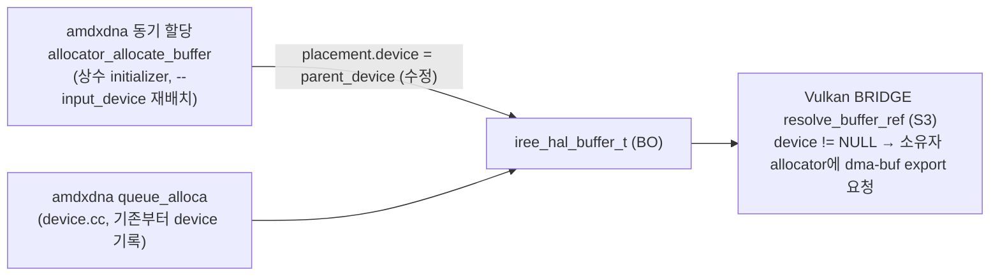

# S2. amdxdna 동기 할당 버퍼의 `placement.device` 기록 (런타임 수정)

- 구분: 런타임 드라이버 수정(팀 플러그인 저장소 `runtime/src/iree-amd-aie/driver/amdxdna/`), 우리 변경(2026-09-28 챕터 10, 테스트 맞춤 2026-09-29 세션1 챕터02)
- 파일: `allocator.cc`(O18~O21), `allocator.h`(O22), `device.cc`(O23), `test/allocator_test.cc`(O24)
- 이유 문서: `docs/2026-09-28/10_amdxdna_동기할당_placement_기록/README.md`, 원인 확정 `docs/2026-09-28/07_공유상수_재확인/README.md`

## 1. 흐름상 위치

런타임 HAL 할당 경로. amdxdna 장치의 `device_allocator`가 버퍼를 만들 때 붙이는 placement 정보다. 이 정보를 **다른 장치가** 읽는다. Vulkan BRIDGE(S3)가 "이 버퍼를 누가 소유하나"를 `iree_hal_buffer_allocation_placement(buf).device`로 묻는다.

## 2. 입력 → 동작 → 출력

- **입력**: `iree_hal_amdxdna_allocator_create(parent_device, host_allocator, native_device, &out)`. `parent_device`는 allocator를 가진 amdxdna HAL 장치이고 **참조를 잡지 않는다**(unowned. 장치가 allocator를 소유하므로 순환 참조를 피한다).
- **동작**: `allocate_buffer`(동기 할당)에서 버퍼 placement를 `{.device = allocator->parent_device, .queue_affinity, .flags}`로 채운다(`allocator.cc:144-154`). 그 전에는 `.device`가 빠져 0(NULL)이었다.
- **출력**: 동기 할당 BO의 `placement.device`가 amdxdna 장치를 가리킨다. `queue_alloca` 경로(`device.cc`)는 원래부터 기록했다.

## 3. 지원 범위와 지원하지 않는 경우

| 경우 | 동작 |
|---|---|
| 동기 할당(상수 initializer의 `stream.resource.alloc`, 툴링 `--input_device` 재배치, 회귀 자동 입력 배치) | 장치 기록됨 → 다른 장치가 소유자에게 export 요청 가능 |
| `queue_alloca`(transient 경계 버퍼) | 기존과 같음(원래 기록됨) |
| 테스트처럼 `parent_device = NULL`로 만든 allocator | placement.device NULL(수정 전과 같음). 단위 테스트 `allocator_test.cc`만 이렇게 쓴다 |
| amdxdna가 **남의** 버퍼를 import | 지원 안 함(amdxdna `import_buffer` 없음, 이 수정과 무관) |

## 4. 기존 대비 변경점

| | 수정 전 | 수정 후 |
|---|---|---|
| 동기 할당 BO의 `placement.device` | NULL | amdxdna 장치 |
| Vulkan이 그 BO를 바인딩할 때 | BRIDGE가 host heap 버퍼로 오인 → host 포인터 export 시도 → amdxdna BO라 실패 → (당시 dispatch BRIDGE는 `continue`) **조용히 결과 0** | 소유자 allocator에 OPAQUE_FD(dma-buf) export → Vulkan import → 정상 |
| `allocator_create` 시그니처 | `(host_allocator, native_device, out)` | `(parent_device, host_allocator, native_device, out)` |
| 관례 | — | Vulkan·HIP 드라이버와 같은 방식(allocator가 parent device를 들고 placement에 기록) |

## 5. 일반성 점검

- 장치·모양·원소 타입 의존 없음. 모든 amdxdna 동기 할당에 같은 규칙이다.
- 업스트림 HAL 관례(placement에 소유 장치 기록)를 따르는 수정이라 다른 드라이버와 같은 의미가 된다.

## 6. 검증 근거

- 실패하던 3케이스 → PASS: mlp2constshared_avl 16384, order_chain2_vla/val 32768(수정 전 rc 0·결과 0의 조용한 오답, 9/28 10 5절).
- 회귀 v5 20/20 PASS 후 v6~v8에 계속 포함(현재 26×2).
- 단위 테스트 `allocator_test` 빌드·PASS(NPU 불필요, `docs/2026-09-29/1_…/02_allocator_test_시그니처수정/README.md`).
