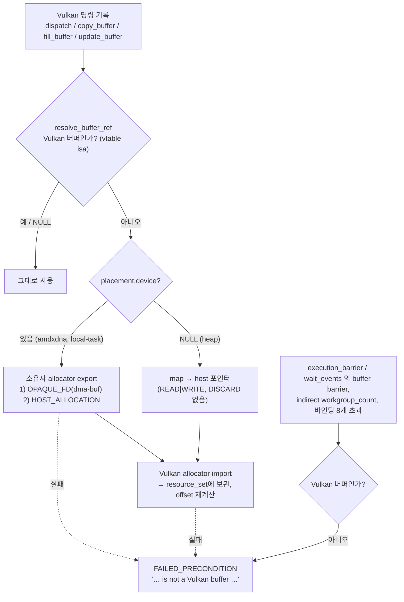

# S3. Vulkan 커맨드 버퍼의 남의 버퍼 처리: BRIDGE 공통화(A) + 명시적 에러(D) (런타임 수정)

- 구분: 런타임 드라이버 수정(IREE 서브모듈 Vulkan HAL). **전임자의 dispatch BRIDGE(장부 Pi14)를 바탕으로** 우리가 공통화·방어를 넣었다(2026-09-28 챕터 09(D), 11(A))
- 파일: `third_party/iree/runtime/src/iree/hal/drivers/vulkan/direct_command_buffer.cc`(I05~I14, I17), `native_buffer.{h,cc}`(I20, I25), `sparse_buffer.{h,cc}`(I26, I27)
- 이유 문서: `docs/2026-09-28/08_Vulkan_copy_buffer_BRIDGE_조사/README.md`(원인), `09_Vulkan_남의버퍼_명시적에러(D)/README.md`, `11_Vulkan_copy_fill_update_BRIDGE(A)/README.md`, offset 회귀 케이스 `docs/2026-09-29/1_구조전환_offset회귀_input_device준비/03_BRIDGE_subspan_offset_회귀케이스/README.md`

## 1. 흐름상 위치

런타임, Vulkan `direct_command_buffer`가 명령을 **기록하는 시점**(`vkCmd*` 호출 직전). 컴파일러가 소유자를 정한 경계 버퍼(S1, S8)나 툴링이 lead 장치로 옮기는 출력이 Vulkan 명령에 들어올 때, 그 버퍼가 VkBuffer가 아니면(amdxdna BO, local-task/heap 버퍼) 여기서 Vulkan 메모리로 import한다.

## 2. 입력 → 동작 → 출력

- **입력**: 명령의 버퍼 참조 `iree_hal_buffer_ref_t {buffer, offset, length}`(dispatch 바인딩, copy source/target, fill·update target).
- **동작** `resolve_buffer_ref`(`direct_command_buffer.cc:151-286`, 판정 `:80`, 방어 `:129`):
  1. NULL이거나 Vulkan 버퍼(`iree_hal_vulkan_native_buffer_isa` 또는 `sparse_buffer_isa`, 할당 버퍼 기준)면 그대로 돌려준다.
  2. 아니면 할당 버퍼의 `placement.device`를 본다.
     - 있으면 그 장치 allocator에 `export_buffer(OPAQUE_FD)`를 먼저, 실패하면 `HOST_ALLOCATION`을 요청한다.
     - NULL(heap)이면 `map_range(PERSISTENT, READ|WRITE)`로 host 포인터를 얻는다. DISCARD를 빼는 이유: debug 빌드 heap이 discard map 때 0xCD로 덮어 입력이 지워졌다(전임자 주석).
  3. Vulkan allocator `import_buffer`(usage = DISPATCH_STORAGE|TRANSFER|MAPPING|MAPPING_PERSISTENT).
  4. import한 버퍼는 **할당 버퍼 전체**를 가리키므로 `offset = src.byte_offset + ref.offset`으로 고친다(subspan 대응, 9/29 v7 회귀 2케이스).
  5. import 버퍼를 커맨드 버퍼 `resource_set`에 넣어 기록이 끝날 때까지 살린다(unretained 커맨드 버퍼도 항상).
  6. export·import가 실패하면 원인 status를 붙여 `FAILED_PRECONDITION`을 돌려준다(op, 역할, 인덱스, memory_type, usage, placement.device 포함).
- **방어(D)**: BRIDGE가 없는 자리(`execution_barrier`·`wait_events`의 buffer barrier, indirect dispatch의 workgroup_count 버퍼, 바인딩이 8개를 넘는 dispatch)는 `require_vulkan_buffer`로 검사해서, 남의 버퍼면 같은 에러를 낸다.
- **출력**: 모든 Vulkan 명령이 Vulkan 버퍼만 받거나, 명시적 에러로 멈춘다. `[BR] import … ok fd=N byte_offset=…` 로그(디버그 로그, 장부 D3).

## 3. 지원 범위와 지원하지 않는 경우

| 경우 | 동작 |
|---|---|
| dispatch 바인딩 ≤ 8개, copy·fill·update의 남의 버퍼 | import해서 실행 |
| amdxdna BO | dma-buf(OPAQUE_FD)로 import |
| local-task 버퍼(placement.device 있음) | HOST_ALLOCATION export → host 포인터 import |
| heap 버퍼(placement.device 없음) | map해서 host 포인터 import |
| dispatch 바인딩 > 8개, buffer barrier, indirect 인자 | **에러**(`FAILED_PRECONDITION`, 조용한 실패 아님) |
| 기록 시점에 아직 commit되지 않은 남의 transient 버퍼(CPU `queue_alloca`가 앞 작업 대기 중) | export 실패 → 에러 `transient buffer has not been committed`(CLAUDE.md 3-2, 10/2 세션2 챕터03). **미해결**: import를 제출 시점(대기 충족 후)으로 미뤄야 함 |
| host 포인터 정렬이 맞지 않음 | Vulkan import 실패 → 에러(정렬 정보 로그) |
| import 캐시 | 없음. 명령마다 export·import한다(성능 부채) |
| fd 수명 | export가 매번 새 fd를 만든다(amdxdna `F_DUPFD_CLOEXEC`). Vulkan 규격상 fd import는 소유권을 구현으로 넘기는데, 전임자 import 주석은 "드라이버가 dup하므로 소유권은 호출자"라고 적었다. **둘이 다르다.** 7절 L-fd: 성공 경로는 규격대로 동작(아무도 닫지 않음, 확인함), 실패 경로는 fd 누수(추정) |
| fill/update에 남의 버퍼가 오는 실제 모델 | 없음(경로는 코드만 있고 실행 검증 모델 없음) |

## 4. 기존 대비 변경점 (전임자 dispatch BRIDGE 대비)

| | 수정 전(전임자, 9/28 기준선) | 수정 후 |
|---|---|---|
| 적용 명령 | dispatch 바인딩만 | dispatch + copy + fill + update(공통 함수 하나) |
| "남의 버퍼" 판정 | `src_allocator == device_allocator`면 건너뜀(같은 allocator만 제외) | vtable로 Vulkan 버퍼인지 판정(native·sparse) |
| export/import 실패 | `[BR]` 로그 후 `continue` → 쓰레기 VkBuffer로 바인딩 → **조용한 오답(결과 0)** 또는 segfault | 에러 반환 |
| subspan(byte_offset ≠ 0) | offset 보정 없음 | `byte_offset + offset` |
| copy_buffer에 남의 버퍼 | `iree_hal_vulkan_buffer_handle()`이 타입 확인 없이 캐스팅 → 툴링 출력 전송에서 segfault(fanout3_val lead0) | import 후 복사 → PASS |
| BRIDGE 없는 자리 | 검사 없음 | 명시적 에러 |
| 로그 | `[BR] import binding[i] …` | 같은 꼴 + 역할 이름·byte_offset(디버그 로그, 장부 D3) |

## 5. 일반성 점검

- 장치 이름 문자열 비교 없음. 판정은 vtable(버퍼 종류)과 placement, export 종류(OPAQUE_FD → HOST_ALLOCATION 순서)로 한다. amdxdna·local-task 외 다른 드라이버 버퍼도 export만 지원하면 같은 경로를 탄다.
- 플랫폼 전제: imported memory를 host-visible로 보고 MAPPING을 허용한다(UMA, 890M). 외장 GPU에서는 dma-buf가 host-visible이 아닐 수 있다. 전임자 메모리 타입 전제(S9)와 같은 한계다.
- 바인딩 8개 상한은 전임자 고정 배열(`patched_bindings[8]`)에서 왔다. 넘으면 에러로 막았지만 상한 자체는 일반적이지 않다.

## 6. 검증 근거

- 9/28 09(D): 회귀 17/17 같음, 새 에러 문자열은 원래 조용히 실패하던 케이스에서만 나옴(09 5-2).
- 9/28 11(A): fanout3_val_lead0 segfault → PASS 16384, 신규 fanout3_vla_lead0·fanout3_avl_lead1 PASS, 회귀 v6 23/23(11 5-3). D 에러 로그 0건.
- 9/29 v7: BRIDGE subspan offset 2케이스 편입 PASS.
- 이후 회귀 26×2, VGG16 3장치(10/2~10/18) 실행에 포함.

## 7. 알려진 한계 (2026-10-20 CP1 결정: 명세에 남기고, 고칠지는 별도 결정)

| # | 한계 | 확인 | 영향 | 고치는 방향(미결정) |
|---|---|---|---|---|
| L-fd | **dma-buf fd 소유권**: amdxdna `export_fd`는 명령마다 `F_DUPFD_CLOEXEC`로 새 fd를 만들어 Vulkan import(`native_allocator.cc:843-` `import_opaque_fd_buffer`)에 넘긴다. 전임자 주석은 "The driver dups the fd during import, so ownership stays with the caller"라고 적었지만, Vulkan 규격(VK_KHR_external_memory_fd)은 **import가 성공하면 fd 소유권이 구현으로 넘어간다**고 정한다(실패하면 앱이 계속 소유). | 확인함(grep): BRIDGE·import 경로에 `close()`가 없다. 유일한 `close`는 테스트 훅(`amdxdna/allocator.cc:176`, `IREE_AMDXDNA_TEST_EXPORT`). → **성공 경로는 규격과 맞게 동작한다**(호출자가 닫지 않음). 주석만 틀렸다. **실패 경로**(`vkGetMemoryFdPropertiesKHR`·memory type 찾기·`vkAllocateMemory` 실패)에서는 fd를 아무도 닫지 않아 **샌다**(코드로 추정, 실행 미검증) | 성공 경로 영향 없음. 실패는 지금 에러로 멈추므로(S3) 새는 fd는 실행당 1개 수준 | (a) 주석을 규격대로 고치고 실패 경로에서 `close` (b) import 캐시와 함께 fd 수명 관리 (c) 긴 실행에서 `/proc/<pid>/fd` 개수 확인 |
