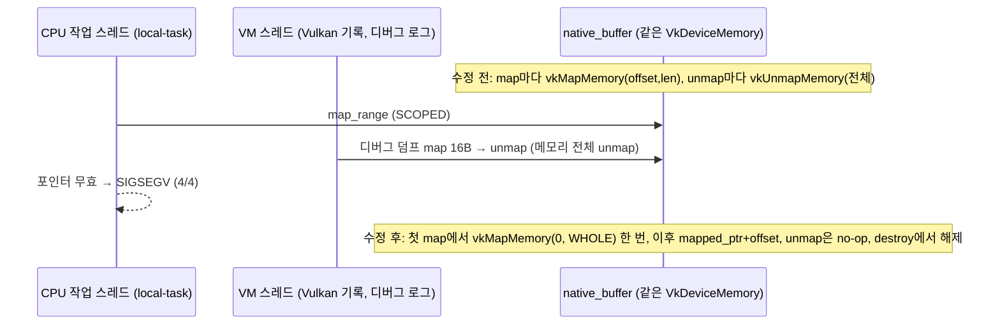

# S4. Vulkan 버퍼 영구 매핑 + 디버그 로그의 map 분리 (런타임 수정)

- 구분: 런타임 드라이버 수정(IREE 서브모듈 Vulkan HAL), 우리 변경(2026-10-02 세션 3 챕터 01·02)
- 파일: `third_party/iree/runtime/src/iree/hal/drivers/vulkan/native_buffer.cc`(I18, I19, I21~I24), `direct_command_buffer.cc`(I05 일부, I15, I16)
- 이유 문서: 발견 `docs/2026-10-02/2_f32_3장치_VGG16_임의배정/03_VGG16_f32_3장치_실행/README.md` 5-3~5-6, 가설 확인 `docs/2026-10-02/3_Vulkan_map_겹침_수정_VGG16_3장치/01_디버그로그_map_분리_가설확인/README.md`, 근본 수정 `…/02_map_참조수_근본수정/README.md`

## 1. 흐름상 위치

런타임 `iree_hal_buffer_map_range`/`unmap_range` → Vulkan `native_buffer` vtable. 호출자는 다음과 같다.
- CPU(local-task) dispatch: GPU 소유 HOST_VISIBLE 버퍼를 SCOPED map 해서 읽고 쓴다(`task_queue.c`). CPU↔GPU 동률 경계 버퍼가 GPU 소유일 때 이 경로를 탄다.
- 툴링: 출력을 읽는다.
- 전임자 디버그 로그: dispatch 바인딩 첫 값 덤프(`[BR] vk dispatch binding … first=`)가 map을 한다.

## 2. 입력 → 동작 → 출력

### 2-1. 영구 매핑 (`native_buffer.cc`)
- **입력**: `map_range(buffer, mode, access, local_byte_offset, local_byte_length)`
- **동작**(`:119-197`):
  1. `mapping_mutex` 아래에서 `mapped_ptr`가 없으면 `vkMapMemory(device_memory, 0, VK_WHOLE_SIZE)`를 **한 번** 한다.
  2. `data_ptr = mapped_ptr + local_byte_offset`. 버퍼가 memoryOffset 0에 바인딩된다는 전제다(주석).
  3. 메모리가 HOST_COHERENT가 아니고 READ 접근이면 `vkInvalidateMappedMemoryRanges(whole)`.
- **unmap**(`:200-230`): 아무것도 unmap하지 않는다. non-coherent 메모리에 WRITE 접근이었으면 `vkFlushMappedMemoryRanges(whole)`.
- **destroy**(`:87-`): `mapped_ptr`가 있으면 `vkUnmapMemory` 후 mutex 해제.
- **출력**: 같은 메모리를 몇 명이 동시에 map해도 같은 기준 포인터를 받는다. 다른 사용자의 unmap이 남의 포인터를 무효로 만들지 않는다.

### 2-2. 디버그 로그 map 분리 (`direct_command_buffer.cc`)
- **입력**: 환경 변수 `IREE_VULKAN_BR_DUMP`(프로세스에서 한 번 읽음, `:1044`)
- **동작**: `=1`이 아니면 dispatch 바인딩마다 **map하지 않고** `buf / dev / type / offset / length`만 `[BR]`로 찍는다. `=1`이면 전임자 동작(16 B map → 첫 4개 값 출력) 그대로.
- **출력**: 기본 실행에서 디버그 로그가 남의 매핑에 손대지 않는다.

## 3. 지원 범위와 지원하지 않는 경우

| 경우 | 동작 |
|---|---|
| HOST_COHERENT 메모리(이 장치의 HOST_VISIBLE 타입 전부, 확인함 10/2) | invalidate·flush 없음 |
| non-coherent 메모리 | 전체 범위 invalidate(map 시 READ)·flush(unmap 시 WRITE). **이 장치에 해당 타입이 없어 실행 검증 안 됨** |
| 버퍼가 memoryOffset ≠ 0으로 바인딩(공유 메모리 부분 할당) | 지원 안 함(전제가 깨짐, 검사 없음). 현재 `native_buffer`는 자체 메모리를 0에 바인딩한다(확인함, 주석 근거) |
| import된 메모리(dma-buf, host ptr)의 map | 같은 경로(영구 매핑)를 탄다 |
| 매핑 수명 | 버퍼가 사라질 때까지 매핑이 유지된다. 가상 주소 공간을 더 오래 쓴다(큰 모델에서 문제 될 수 있음, 미측정) |
| `IREE_VULKAN_BR_DUMP=1` | 덤프를 켜도 영구 매핑 덕에 안전(10/2 세션 3 챕터 02 iii 조건 3/3) |

## 4. 기존 대비 변경점

| | 수정 전(업스트림 + 전임자 로그) | 수정 후 |
|---|---|---|
| map | 호출마다 `vkMapMemory(offset, length)`. 이미 map된 메모리를 다시 map하면 규격 위반 | 처음 한 번 전체 map, 이후 포인터 계산 |
| unmap | 호출마다 `vkUnmapMemory`(메모리 객체 전체) | 없음(destroy에서 한 번) |
| 동시 map | 겹치면 한 쪽 unmap이 다른 쪽 포인터를 무효화 | 안전(mutex로 첫 map만 직렬화) |
| 업스트림 TODO | "map VK_WHOLE_SIZE and subset ourselves?"(benvanik) | 그 TODO를 구현한 꼴 |
| 디버그 바인딩 덤프 | 항상 map | 기본은 map 없이 ref 정보만, `IREE_VULKAN_BR_DUMP=1`일 때만 map |

## 5. 일반성 점검

- 장치·모양·원소 타입 의존 없음. non-coherent 처리를 넣어 coherent 전제를 코드에 박지 않았다(단 non-coherent는 미검증).
- 업스트림에 낼 수 있는 일반 수정이다(업스트림 TODO와 같은 방향). 디버그 로그 분리(I15·I16)는 전임자 디버그 코드 위의 수정이라, 디버그 코드를 정리하면 같이 정리된다(챕터 04).

## 6. 검증 근거

- 챕터 01(가설 확인): 같은 vmfb(맵 1/15/43)가 4/4 SIGSEGV → 디버그 map을 끄자 5/5 끝까지 실행. 회귀 26×2 같음.
- 챕터 02(근본 수정): 디버그 map을 켠 원래 조건(iii)도 3/3 통과, 출력 비트 동일. 회귀 26×2 같음.
- 이후 10/18 VGG16 NPU9/GPU4/CPU46 3/3, 10/19 세마포어 시험 281회에 포함.
