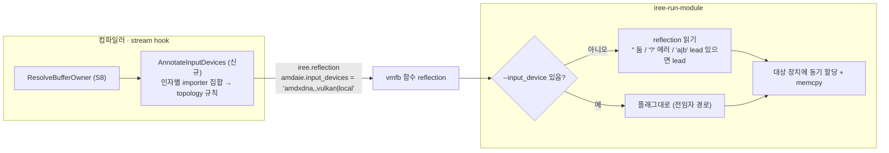

# S5. `AMDAIEAnnotateInputDevices` + 실행 도구의 입력 자동 배치 (신규 Pass + 도구 수정)

- 구분: **신규 Pass**(플러그인 stream hook) + 툴링 수정(IREE 서브모듈 `iree-run-module`), 우리 변경(2026-09-29 세션 2 챕터 02, 설계 세션 1 챕터 04)
- 파일: `compiler/plugins/target/AMD-AIE/iree-amd-aie/Transforms/AMDAIEAnnotateInputDevices.cpp`(N01), 등록 O01(a)·O11·O12·O13·O15·O16, lit `Transforms/test/annotate_input_devices.mlir`(N03), `third_party/iree/runtime/src/iree/tooling/run_module.c`(I28~I32)
- 이유 문서: `docs/2026-09-29/1_구조전환_offset회귀_input_device준비/04_input_device_자동화_설계/README.md`, `docs/2026-09-29/2_VGG16상수묶음확인_input_device자동화/02_input_device_자동화_구현/README.md`
- 바탕: 전임자 EXPERIMENT `--input_device`(장부 Pi55~57, device group 전역 Pi46~49) — S9

## 1. 흐름상 위치

- 컴파일러: Stream 단계 끝의 플러그인 stream hook(`Pipelines.cpp:416-418`). `AMDAIEResolveBufferOwner`(S8) **바로 뒤**. 이 시점에 `stream.tensor.import on(<affinity>) %argK`의 affinity가 최종이다.
- 런타임: `iree-run-module` 함수 호출 직전, 입력 리스트를 만든 뒤(`run_module.c:275-414`).

## 2. 입력 → 동작 → 출력

### 2-1. 패스
- **입력**: 모듈(`stream.topology`, device global 선언 순서, 공개 진입점 `util.func`의 `stream.tensor.import`)
- **동작**:
  1. topology가 없으면 아무것도 안 한다.
  2. device global을 선언 순서대로 `@__device_N → (N, target ID)`로 모은다(ID = `#hal.device.target<"id">`).
  3. 공개 진입점(`iree.abi.stub`)마다, 인자 K를 import하는 affinity 집합(importer)을 모은다. `CloneToConsumers`가 소비 장치마다 import를 하나씩 만들므로 집합이 여러 개일 수 있다.
  4. 인자마다 **경계 버퍼와 같은 규칙**: `Q = { X ∈ importers | 모든 importer Y가 (Y → X) transparent_access }`.
     - |Q| = 1 → 그 장치 ID
     - |Q| ≥ 2 → `a|b`(선언 순서)
     - Q = ∅ 또는 ID를 알 수 없는 장치 → `?` + **경고**(`emitWarning`)
     - import 안 됨(스칼라 등) → 빈 칸
  5. `$async` 함수만 import를 가지면, 그것을 `util.call`하는 sync 래퍼에 인자 번호를 다시 맞춰 같은 값을 넣는다.
- **출력**: 함수 `iree.reflection`에 `amdaie.input_devices`(장치 ID, `,` 구분)와 `amdaie.input_device_ordinals`(디버그용 `@__device_N` 번호). **IR은 바꾸지 않는다.**

### 2-2. 도구 (`run_module.c`)
- **입력**: `--input_device` 목록(있으면 우선), 함수 reflection `amdaie.input_devices`, `--device` 목록(device group)
- **동작**:
  1. `--input_device`가 하나라도 있으면 전임자 경로(인덱스 = `--device` 순서).
  2. 없고 reflection이 있으면 항목별로 처리한다.
     - 빈 칸: 둔다.
     - `?`: `FAILED_PRECONDITION`(추측하지 않음).
     - 후보마다 `hal.device.id`를 패턴 `<id>*`로 `--device` 목록에서 찾는다(`iree_tooling_find_device_by_id`, 컴파일된 모듈이 device global을 고르는 것과 같은 질의). 없으면 `NOT_FOUND`.
     - 후보 중 lead 장치가 있으면 옮기지 않는다(`-> lead`). 없으면 첫 후보로 옮긴다.
  3. 옮길 때는 전임자 코드 그대로 대상 장치 allocator에 **동기 할당 + memcpy**.
- **출력**: 입력 버퍼가 대상 장치 소유가 된다. 로그 `[BR] input[i] -> device N (ok, flag|reflection)` / `-> lead (reflection '…')`.

## 3. 지원 범위와 지원하지 않는 경우

| 경우 | 동작 |
|---|---|
| topology 없는 모듈(1장치 등) | 패스 무동작 → reflection 없음 → 도구는 아무것도 옮기지 않음 |
| 인자 하나를 여러 장치가 import | 경계 버퍼와 같은 규칙. 지금 표에서는 NPU→CPU·GPU 칸이 false라 NPU가 낀 입력은 NPU로 정해진다 |
| 동률(CPU↔GPU) | `a|b`. 도구가 lead를 우선한다(lead 의존, 1-3 "10/19 형 확인" 질문 3 미확인) |
| 아무 장치도 자격이 없음 | 컴파일 경고 + `?`, 실행 시 에러(`--input_device`로 지정해야 함) |
| reflection의 장치 ID가 `--device`에 없음 | 실행 에러 |
| `iree-run-module` 외 런타임(사용자 앱, Python 바인딩) | **지원 안 함**. reflection을 읽는 곳은 `run_module.c`뿐이다. 다른 호스트 코드는 직접 읽어야 한다 |
| 입력을 옮기는 비용 | 동기 할당 + memcpy(입력을 lead에 두려면 `--input_device`로 lead 인덱스를 적음, CLAUDE.md 0절) |

## 4. 추가 목적 (신규)

- 회귀·VGG 실행마다 사람이 `--input_device`를 장치 순서에 맞춰 적던 것(전임자 EXPERIMENT)을, 컴파일러가 정한 import 장치로 자동화한다(로드맵 1단계).
- 경계 버퍼와 같은 topology 규칙을 입력에도 적용해 "입력은 lead에" 같은 별도 규칙을 만들지 않는다.
- 도구 쪽은 "플래그가 있으면 플래그 우선"이라 기존 사용법은 바뀌지 않는다.

## 5. 일반성 점검

- 장치 이름 비교 없음. 장치 ID는 IR의 `#hal.device.target<"id">`에서 읽고, 도구는 HAL 질의 `hal.device.id`로 찾는다.
- 규칙이 topology 표에만 의존한다. NPU import가 생겨 표가 바뀌면 결과도 따라 바뀐다.
- reflection 키 이름에 `amdaie.`가 붙어 있다. 플러그인 소유라는 표시일 뿐 내용은 백엔드와 무관하다. 다만 업스트림 `iree-run-module`(서브모듈)이 플러그인 키를 읽는 의존이 생겼다. 팀·업스트림에 낼 때는 키 이름을 중립으로 바꿀지 정해야 한다(챕터 04 질문 후보).
- 설계 결정: 2장치 lead=local-task 2케이스(cg_topo_lead0, mm_probe_lead0)는 자동 모드에서 입력을 GPU로 옮긴다(CLAUDE.md 3-1-1).

## 6. 검증 근거

- lit `annotate_input_devices.mlir` RUN#1(FileCheck)·RUN#2(verify-diagnostics) PASS(9/29 세션2 챕터02 5-2).
- 회귀: 수동 25/25가 수정 전과 한 글자도 다르지 않음, reflection 기대값 25 + npu2out 일치. v8에서 자동 모드 추가 → **수동 26/26, 자동 26/26**(이후 모든 세션 유지).
- 알려진 lit FAIL `assign_device_affinities.mlir @host_only`는 이 변경과 무관(CLAUDE.md 3-2, 원인 추정).
