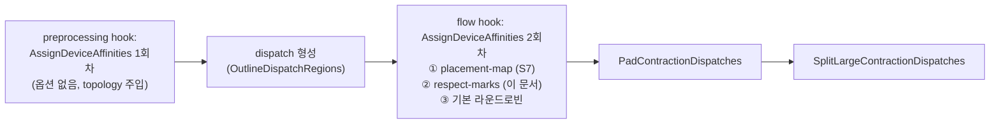

# S6. `respect-marks` 옵션 (수정 Pass, 기본 꺼짐, 디버그용)

- 구분: **수정 Pass**(팀 `AMDAIEAssignDeviceAffinities`에 옵션 추가), 우리 변경(2026-10-01 세션 2 챕터 01 설계·02 구현). C안(보류) 1단계에서 만들었고, 10/1 결정으로 **디버그용으로 유지**(CLAUDE.md 3-1 방향 변경)
- 플래그: `--iree-amdaie-respect-affinity-marks`(기본 false). 패스 옵션 `respect-marks`
- 파일: `Transforms/AMDAIEAssignDeviceAffinities.cpp`(O06 `readExecutableMark`·생성자, O07 respect 분기, O08 `markFailed`, O10), `Passes.td`(O14), `Passes.h`(O13), `Target/AIETarget.h`(O02·O03), `PluginRegistration.cpp`(O01 b), lit `Transforms/test/assign_device_affinities_respect_marks.mlir`(N04)
- 이유 문서: `docs/2026-10-01/2_C안_1단계_S1_respect_marks/01_설계/README.md`, `02_구현과_기본값_불변_검증/README.md`, 켜짐 검증 `03_옵션_켜짐_C안_IR_검증/`, `04_V1_3장치_실행/`

## 1. 흐름상 위치

Flow 단계 플러그인 flow hook의 첫 패스(`PluginRegistration.cpp` `extendFlowTransformPassPipeline`). 뒤에 팀 `AMDAIEPadContractionDispatches`, `AMDAIESplitLargeContractionDispatches`가 온다. 같은 패스가 preprocessing hook에서도 한 번 더 돌지만(1회차, dispatch 없음) 그쪽은 **옵션을 받지 않는다**.

## 2. 입력 → 동작 → 출력

- **입력**: `flow.dispatch`(기존 `stream.affinity`가 있을 수 있음), 그 dispatch가 부르는 `flow.executable` 안 linalg op의 `stream.affinity = #hal.device.affinity<@dev>` 표식(사람이 IR에 손으로 넣은 것)
- **동작**(옵션이 켜졌을 때만, dispatch마다):
  1. placement-map 규칙이 맞으면 그쪽이 먼저다(S7).
  2. dispatch에 이미 `stream.affinity`가 있으면 **그대로 둔다**(덮어쓰지 않음).
  3. 없으면 첫 entry point executable 안에서 표식을 읽는다(`readExecutableMark`). contraction/conv 루트의 표식이 우선이고, 없으면 walk 순서 첫 표식을 쓴다. 표식끼리 다르면 경고. 표식이 `#hal.device.affinity`가 아니면 에러.
  4. 표식이 배정 대상 장치(accelerator·host 목록)가 아니면 에러.
  5. 표식이 있으면 그 장치로 고정한다. **라운드로빈 순번은 쓰지 않는다**(뒤 dispatch의 기본 배정이 밀리지 않음).
  6. 표식이 없으면 기본 라운드로빈으로 간다.
- **출력**: dispatch의 `stream.affinity`. 에러가 하나라도 있으면 `signalPassFailure`.

## 3. 지원 범위와 지원하지 않는 경우

| 경우 | 동작 |
|---|---|
| 옵션 꺼짐(기본) | 이 분기를 아예 타지 않는다(`executablesByName`도 안 만듦) → 기존 동작과 바이트 단위 같음(아래 6) |
| dispatch에 affinity 있음 | 유지 |
| executable 안 표식 | 루트 표식 우선, 충돌은 경고 |
| 표식 형식 오류 / 배정 대상이 아닌 장치 | 에러로 컴파일 실패 |
| 1회차(preprocessing) | 옵션 미적용(dispatch가 없어 영향 없음) |
| 표식 장치가 그 연산을 코드젠할 수 있는지 | **검사하지 않는다**(placement-map은 NPU 능력 경고를 내지만 respect-marks는 안 냄) |

## 4. 기존 대비 변경점

| | 수정 전(팀·전임자) | 옵션 켬 |
|---|---|---|
| 기존 dispatch affinity | 무조건 덮어씀("Placement is unconditional", 패스 머리 주석) | 유지 |
| 손으로 쓴 IR 표식 | 무시 | 그 장치로 고정 |
| 라운드로빈 순번 | 모든 contraction이 순번을 씀 | 표식으로 고정한 dispatch는 순번을 안 씀 |
| 옵션 끔 | — | 수정 전과 같음 |

## 5. 일반성 점검

- 장치 이름 비교 없음(표식은 device global 심볼로 비교).
- 패스 머리 주석이 "두 번째 가속기 플러그인이 생기면 기존 affinity를 건너뛰는 것이 최소 조건"이라고 적었다. respect-marks의 (2)가 그 조건을 옵션으로 제공한다. 기본값으로 켤지는 팀 결정이다(지금은 디버그용).
- 용도가 "손으로 고친 IR을 끝까지 컴파일"이라 실험·디버그 도구다. 배정 정책으로 쓰지 않는다(1-4의 1).

## 6. 검증 근거

- 기본값 불변: VGG16 2장치 재컴파일 vmfb sha256 `10a29952…f7e46`가 기존 `b`와 `cmp` 바이트 동일, 회귀 26×2 표 전 행 같음(10/1 세션2 챕터02 5절).
- lit: 새 `assign_device_affinities_respect_marks.mlir` PASS. 실패 목록(`@host_only`, `control_packets`)은 기준선과 같음.
- 옵션 켜짐: C안 IR 검증(챕터 03), V1 3장치 실행(챕터 04).
