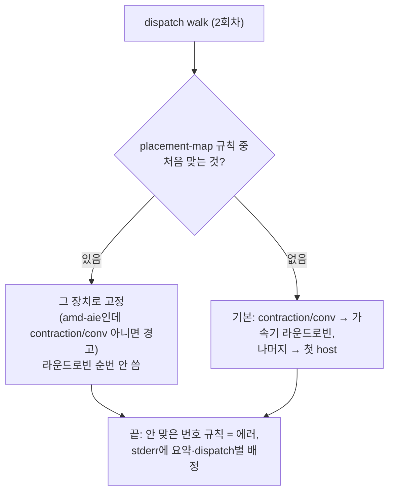

# S7. `placement-map` 배정 지정 옵션 (신규 옵션, 기본 꺼짐, 실험용)

- 구분: **수정 Pass에 신규 옵션**(팀 `AMDAIEAssignDeviceAffinities`), 우리 변경(2026-10-02 세션 2 챕터 02). f32 VGG16 3장치 실험(배정을 dispatch별로 지정)의 수단이다. 맵 자체는 우회 산출물이다(장부 5절 W01~W06, K2)
- 플래그: `--iree-amdaie-placement-map='<규칙>;<규칙>…'` 또는 `'@<파일>'`(기본 빈 문자열 = 꺼짐)
- 파일: `Transforms/AMDAIEAssignDeviceAffinities.cpp`(O05 include, O06 규칙 파서·`ruleMatches`, O07 map 분기, O08 죽은 규칙 에러·stderr 요약, O09 topology host 추가), `Passes.td`(O14), `Target/AIETarget.h`(O02·O03), `PluginRegistration.cpp`(O01 b), lit `Transforms/test/assign_device_affinities_placement_map.mlir`(N05, RUN 19줄)
- 이유 문서: `docs/2026-10-02/2_f32_3장치_VGG16_임의배정/02_배정_지정_플래그/README.md`

## 1. 흐름상 위치

flow hook 첫 패스(`AMDAIEAssignDeviceAffinities`) 2회차. 2회차 안에서 **가장 먼저** 본다: placement-map → 기본 라운드로빈.

## 2. 입력 → 동작 → 출력

- **입력**: 규칙 문자열(`;` 구분, 또는 `@파일`이면 한 줄에 하나, `#` 주석). 규칙 = `<선택자>=<장치>`
  - 선택자: `dN`, `dN-dM`, `dA,dB,…`(executable 이름 `<func>_dispatch_N`의 N. `OutlineDispatchRegions`가 배정 전에 붙인 번호), `~부분문자열`(executable·export 이름), `*`
  - 장치: `npu`/`gpu`/`cpu` = 백엔드 `amd-aie`/`vulkan-spirv`/`llvm-cpu`인 **첫** device global, 또는 `@<device global 이름>`
- **동작**:
  1. 파싱하면서 장치를 모듈의 배정 대상 장치에 맞춰 본다. 문법 오류, 모르는 장치, 그 백엔드 장치 없음, 범위가 거꾸로 됨 → 에러.
  2. dispatch마다 번호(N, 없으면 -1)를 구하고 규칙을 앞에서부터 본다. 처음 맞는 규칙의 장치로 고정한다. amd-aie로 고정했는데 executable이 contraction/conv가 아니면 경고(amd-aie가 못 내릴 수 있음).
  3. 맞는 규칙이 없으면 기본 배정으로 넘긴다.
  4. walk 뒤: 번호 규칙이 하나도 안 맞았으면(오타 또는 앞 규칙에 가려짐) 에러. dispatch가 없는 실행(1회차에 해당하는 경우)에서는 검사하지 않는다.
  5. stderr에 `[amdaie placement-map] rules=… dispatches=… npu=… gpu=… cpu=… unmatched=…`, 규칙별 맞은 수, dispatch별 `dN  export  rule#k …  @dev (label)`을 찍는다(옵션을 줄 때만).
  6. topology 주입 블록: 맵이 켜졌으면 첫 host가 아닌 host도 사용됐을 때 링크에 넣는다(O09). **아래 3절 주의**.
- **출력**: dispatch `stream.affinity`, stderr 배정표.

## 3. 지원 범위와 지원하지 않는 경우

| 경우 | 동작 |
|---|---|
| 옵션 비움(기본) | 맵 분기를 타지 않음 → 기존과 같음(아래 6) |
| 같은 모델·같은 플래그 | 번호가 안정적이다. **모델이나 플래그가 바뀌면 번호가 바뀐다**(예: VGG16 demote 유무로 59 ↔ 89개). 맵은 모델 + 플래그 조합마다 따로 둔다(10/2 문서) |
| 배정 뒤에 생기는 dispatch(팀 pad/crop/N-split) | 맵이 보지 못한다(배정 시점에 없음). 06 덤프 개수와 맵 개수가 다를 수 있다 |
| `~` 규칙이 하나도 안 맞음 | 에러 아님(목록만 보는 용도 `~__none__=cpu`) |
| 1회차(preprocessing) | 옵션 미적용 |
| 같은 백엔드 장치가 둘(예: GPU 2개) | `gpu`는 첫 번째만 가리킨다. 둘째는 `@이름`으로 지정해야 한다 |
| 장치가 그 연산을 코드젠할 수 있는지 | NPU에 비 contraction을 보낼 때만 경고. 그 밖의 능력(f32 지원, DMA 반복 등)은 **검사하지 않는다**(우회 W07·W10의 원인) |
| **topology 좁히기와 O09** | **실제 파이프라인에서는 실행되지 않는다(확인함).** topology는 1회차(옵션 없음)가 모든 가속기 + 첫 host로 이미 주입하고, 2회차는 `if (!moduleOp->hasAttr("stream.topology"))`에서 건너뛴다. 근거: GPU에 dispatch 0개인 NPU13 맵 컴파일(`/home/mkchoi/iree-work/dma/vgg13/peek_flow.mlir`, `check_assign.txt` "gpu=0")에도 topology에 `@__device_1`(vulkan) 링크가 남아 있다. 좁히기·O09는 패스를 단독으로 돌리는 lit(LST 케이스)에서만 실행된다. 10/2 문서 57행 "topology는 2회차의 usedRefs로 좁혀진다"는 **패스 단독 실행에만 맞는 말**이다. 영향(추정): 쓰지 않는 장치 링크가 남아도 소유자 결정(S8)은 `optimal` 후보 안에서만 고르므로 결과가 같다 |

## 4. 기존 대비 변경점

| | 수정 전 | 옵션 줌 |
|---|---|---|
| 배정 수단 | 라운드로빈(선언 순서 × dispatch 순서)뿐. 특정 dispatch를 특정 장치에 보낼 방법 없음 | 번호·이름 규칙으로 dispatch별 고정 |
| 라운드로빈 순번 | 모든 contraction이 씀 | 맵으로 고정한 dispatch는 안 씀 |
| 진단 | 배정 결과를 보려면 IR 덤프 | stderr 배정표 |
| 옵션 비움 | — | 수정 전과 같음 |

## 5. 일반성 점검

- **특정 모델 의존**: 번호 선택자는 "같은 모델·같은 플래그"에서만 의미가 있다. 맵 파일은 모델 전용 산출물이고, 옵션은 실험 도구다. 배정 정책(로드맵 5단계, 10/19 보류)을 대신하지 않는다. → 1-4의 1에 걸리는 부분이다. 실험용 옵션으로 두는 이유와 범위: "dispatch 단위 배정 구조를 유지한 채 장치별 실행 가능성을 손으로 시험"(10/1 팀 결정). 팀에 올릴 때는 이 범위를 명시하고 승인받아야 한다(챕터 04).
- **장치 별칭**: `npu`/`gpu`/`cpu` → 백엔드 이름 문자열(`amd-aie`/`vulkan-spirv`/`llvm-cpu`) 고정 표(`StringSwitch`, `deviceLabel`). 이유: `deviceRole`이 NPU와 GPU를 둘 다 Accelerator로 분류해 역할만으로는 구분할 수 없다. 새 백엔드는 `@이름`으로 지정할 수 있다.
- 원소 타입·모양 의존 없음.

## 6. 검증 근거

- lit: 새 `assign_device_affinities_placement_map.mlir` PASS(RUN 19줄: 번호·범위·목록·부분 문자열·`@이름`·`*`, 처음 맞는 규칙, 순번 안 씀, NPU 능력 경고, topology 축소(단독 실행), 에러 6종, stderr 요약). 기존 실패 목록 같음.
- 기본값 불변: 회귀 26×2 표 전 행 같음, VGG16 2장치 vmfb 같은 경로로 재컴파일 시 sha256 `10a29952…f7e46` 바이트 동일(10/2 세션2 챕터02 5절. 경로가 다르면 vmfb에 입력 경로가 들어가 달라짐).
- 사용: VGG16 f32 3장치 맵 W01~W06(10/2~10/18).

## 7. 알려진 한계 (2026-10-20 CP1 결정: 명세에 남기고, 고칠지는 별도 결정)

| # | 한계 | 확인 | 영향 | 고치는 방향(미결정) |
|---|---|---|---|---|
| L1 | **topology 좁히기와 O09(첫 번째가 아닌 host 추가)는 실제 파이프라인에서 실행되지 않는다.** 1회차(preprocessing, 옵션 없음)가 모든 가속기 + 첫 host로 topology를 주입하고, 2회차는 `if (!moduleOp->hasAttr("stream.topology"))`에서 건너뛴다 | 확인함: GPU dispatch 0개 맵 컴파일 `/home/mkchoi/iree-work/dma/vgg13/peek_flow.mlir`에 `@__device_1`(vulkan) 링크가 남음 | 추정: 소유자 결정(S8)은 `optimal` 후보 안에서만 고르므로 결과가 같다. 두 번째 host로 일을 보낸 맵은 그 host가 topology에 없어 경계 처리에서 빠질 수 있다(시험한 맵에는 없음) | (a) O09·좁히기 코드를 지우고 "topology = 선언된 배정 대상 전부"로 명세 확정 (b) 2회차에서 topology를 다시 계산(사용자 지정 topology와 구분 필요) (c) 그대로 두고 lit 전용임을 주석으로 |
| L2 | 10/2 문서(`docs/2026-10-02/2_…/02_…/README.md` 57행)의 "topology는 2회차 usedRefs로 좁혀진다"는 패스 단독 실행에만 맞다 | 위와 같음 | 문서 오해 | 옛 문서는 고치지 않고 이 절로 정정 |
