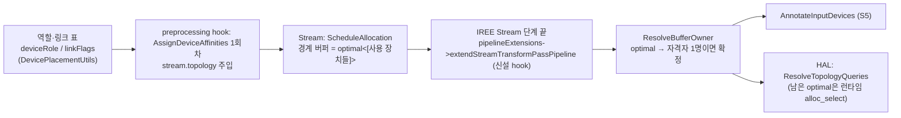

# S8. 전임자: `AMDAIEResolveBufferOwner` + stream hook + 역할·링크 표 + `accelIdx` (신규 Pass·IREE 수정, **우리는 검증만** → 2026-11-06 동률 규칙 추가는 우리, 7절)

- 구분: **전임자(최민규) 코드, 9/28 인수인계 기준선**. 우리가 바꾼 것은 `linkFlags` 주석 한 곳(O17, 10/2 세션1 챕터00)뿐이다. 나머지는 검증만 했다. → (2026-11-06) `AMDAIEResolveBufferOwner.cpp`에 **소유 자격자가 둘 이상(동률)일 때의 규칙**을 넣었다(우리, 브랜치 `feature/gpu-dispatch-fixed-cost`, 7절).
- 파일
  - 플러그인: `Transforms/AMDAIEResolveBufferOwner.cpp`(N02, 9/28 기준선과 바이트 동일), 등록 `PluginRegistration.cpp`(Pp01), `Passes.td`·`Passes.h`·`PassDetail.h`·`CMakeLists.txt`(Pp03~07), 역할·링크 표 `Transforms/Utils/AMDAIEDevicePlacementUtils.cpp`(Pp08 + O17), `AMDAIEAssignDeviceAffinities.cpp` `accelIdx = 0`(Pp02)
  - IREE 서브모듈: stream hook API `compiler/src/iree/compiler/PluginAPI/Client.h`(Pi02), `PluginManager.h`(Pi03), 호출 `Pipelines/Pipelines.cpp:416-418`(Pi01)
- 이유·검증 문서: `docs/2026-09-28/01_인수인계_코드현황_파악/README.md` 3-2, `03_소유자결정_topology_검증보강/README.md`, `04_transparent_access_방향정의_확인/README.md`, `05_경계버퍼_전케이스_정리/README.md`, `docs/2026-10-19/2_발표피드백_조사/01_…`(topology 피드백 조사)
- 1-3 기록: "10/19 형 확인" — 요구사항은 "topology 표를 보고 소유자를 고른다"이고 지금 구조가 충족한다. NPU import는 필요할 때 한다.

## 1. 흐름상 위치

- **stream hook**: IREE에 없던 플러그인 확장점이다. `Client.h`에 `extendStreamTransformPassPipeline` 가상 함수를 추가했고, `PluginManager.h`는 모든 세션에 이를 전달하며, `Pipelines.cpp`는 `buildStreamTransformPassPipeline` 직후·`afterPhase(Stream)` 전에 호출한다.
- **ResolveBufferOwner**: 그 hook의 첫 패스다. `ScheduleAllocation`이 경계 버퍼에 `#hal.device.optimal<[...]>`(실제 사용 장치 집합, `ScheduleAllocation.cpp` `joinOR(usageAffinities)`)을 붙인 뒤에 돈다.

## 2. 입력 → 동작 → 출력

### 2-1. `AMDAIEResolveBufferOwner` (`AMDAIEResolveBufferOwner.cpp`, 53줄 → 2026-11-06 동률 규칙 추가 후 168줄)
- **입력**: `stream.topology`, `AffinityOpInterface` op(alloca·dealloca 등) 중 affinity가 `#hal.device.optimal<[X1..Xn]>`인 것
- **동작**: 후보 X마다 "모든 후보 Y가 `(Y → X) transparent_access`"인지 본다(같은 장치는 true, `HALAttrs.cpp:1129-1131`). 자격자가 **정확히 1명**이면 그 장치로 affinity를 바꾼다.
- **출력**: 확정된 단일 affinity. 0명이면 `optimal` 그대로 → 런타임 `hal.allocator.select`가 lead(`--device_lead_allocator`, 기본 0)로 고른다. 2명 이상(동률)이면 7절 동률 규칙으로 정하고, 그래도 정해지지 않으면 `optimal` 그대로 → 런타임 lead.
- topology가 없으면 무동작.

### 2-2. 역할·링크 표 (`AMDAIEDevicePlacementUtils.cpp`)
- `deviceRole(backend)`: `llvm-cpu` → Host, `amd-aie` → Accelerator, `vulkan-spirv` → Accelerator(10/20 시점에는 `// TEMP: experiment` 표식. dev 통합 때 표식을 떼고 정식 역할로 둠, `e7060e40`), 그 외 Unknown.
- `linkFlags(src, dst)` = `(src → dst)`의 `{unified_memory, transparent_access}`. "src가 dst 메모리를 복사 없이 읽는다".

| src → dst | transparent | 근거(주석) |
|---|---|---|
| CPU → NPU | true | amdxdna BO는 host-local·device-visible, CPU가 host-map |
| NPU → CPU | **false** | amdxdna HAL allocator에 `import_buffer` 없음(드라이버 소프트웨어 한계, 커널 드라이버는 dma-buf·userptr 지원) |
| CPU → GPU | true | Vulkan dispatch 메모리가 DEVICE_LOCAL\|HOST_VISIBLE\|HOST_COHERENT(이 플랫폼). 외장 GPU면 false여야 함 |
| GPU → CPU | true | host 포인터 import + BRIDGE(S3). (O17: 옛 TODO를 "검증됨 cg_topo lead=0"으로 교체) → 통합 후: **false**. BRIDGE가 기록 시점에 import해서 아직 메모리가 없는 transient CPU 버퍼를 못 가져오므로, CPU·GPU 공유 버퍼는 GPU가 소유(`e3d86485`) → (11/05, 브랜치 `feature/cpu-gpu-shared-buffer` `cb41b711`) **true**. false의 두 이유가 해결됐다: transient 가져오기 실패는 Vulkan이 남의 semaphore 대기 뒤에 기록하게 한 수정(fork `210f677`, S3)으로, 정리 단계 abort는 완료 공개 전 해제(S11)로. 지금 표에서는 이 칸과 CPU → GPU 칸이 모두 true라 CPU·GPU 공유 버퍼는 동률이고 lead 장치가 할당한다. 판단 근거(2026-11-05 세션 1 챕터 03, 전원 모드 default): GoogLeNet CPU+GPU lead CPU 3,000회, 경합 `cg_softmax`·`softmax_first` N=512 각 300회, 최소 재현 2종 각 1,000회, GPU 단독 100회, lead GPU 300회, 회귀 v10 28×2, VGG16 CPU+NPU+GPU f32, 지연 진단 9가지 1,150회에서 abort·잘못된 출력·실패 종료 0. 멈춤은 lead GPU 2건뿐이고 원래 Vulkan `queue_alloca` 대기 자리이며 링크 false와 같은 빈도(2/300). → (11/05) dev에 합친다(박사형 결정, 통합 브랜치 `integrate/vulkan-order-link-true` `7aba8545`). dev 통합 기준 검증: VGG16·MLP 6조합 출력이 dev와 바이트 단위로 같고 dispatch별 장치도 같다(링크 표는 버퍼 소유만 바꿈), ctest 실패 목록 dev와 같음, 회귀 v10 28×2 |
| GPU → NPU | true | amdxdna dma-buf export → Vulkan import(S9) |
| NPU → GPU | **false** | amdxdna import 없음, Vulkan export 없음 |
| 그 외 | false·false | 보수적 기본값(복사) |

### 2-3. `accelIdx = 0` (`AMDAIEAssignDeviceAffinities.cpp`)
- 라운드로빈 시작 가속기를 HEAD의 1에서 0으로 바꿨다(9/7 mtime). 첫 contraction → 선언 순서 첫 가속기.

## 3. 지원 범위와 지원하지 않는 경우

| 경우 | 동작 |
|---|---|
| 자격자 1명 | 확정. 지금 표에서는 NPU→CPU·NPU→GPU 칸이 false라, NPU가 낀 경계는 NPU로 정해진다 |
| 자격자 2명(CPU↔GPU 서로 true) | `optimal` 유지 → 런타임 lead가 고른다(lead = 선언 순서 의존. 1-3 "10/19 형 확인" 질문 3 **미확인**) → (2026-11-06) 실행 함수(initializer가 아닌 함수)에서 그 자원을 쓰는 장치가 자격자 하나뿐이면 그 장치로 정한다(7절). 그 밖에는 지금처럼 `optimal` 유지 |
| 자격자 0명 | `optimal` 유지 → 런타임이 고르고, 읽을 수 없는 장치가 생기면 실행 시 실패할 수 있다(지금 표에서는 생기지 않음) |
| 3장치 이상 | 같은 규칙(∀Y (Y→X)). 업스트림 `ResolveTopologyQueries`는 ∃X ∀Y (X→Y)로 양화가 달라 3장치 이상에서 다를 수 있다. 지금은 이 패스가 먼저 확정해서 가려져 있다(CLAUDE.md 3-2) |
| 표가 바뀜(예: NPU import 구현) | 표 한 칸만 바꾸면 소유자가 자동으로 바뀌는 구조(9/28 발표 남은 과제 3) |

## 4. 추가 목적 / 기존 대비 변경점

- **추가 목적**: 런타임의 `"amdxdna"` 문자열 규칙(후보에 NPU가 있으면 NPU)을 없애고, 컴파일러가 topology 표로 소유자를 고르게 한다(9/21 피드백 ① "하드코딩 제거, topology 기반 할당"). 런타임 문자열 규칙은 9/28 기준선에서 이미 지워져 있었다(9/28 01 3-2 참고).
- **기존 대비**: HEAD에는 hook·패스가 없다. 그래서 `optimal`이 모두 런타임 lead/문자열 규칙으로 갔다.

## 5. 일반성 점검

- 패스 본문은 장치 이름을 보지 않는다(topology만).
- 표는 **백엔드 이름 문자열**(`llvm-cpu`, `amd-aie`, `vulkan-spirv`)을 키로 쓴다. "표가 유일한 진실 원천" 설계라 이름이 이 한 곳에만 모여 있다. 다만 다음 두 전제가 깔려 있다.
  - **플랫폼 전제**: CPU→GPU true는 UMA(890M) 전제다. 외장 GPU에서는 성립하지 않는다(주석 NOTE).
  - **vulkan-spirv 역할**: 10/20 시점에는 Accelerator로 둔 것이 TEMP 표식이었다. dev 통합 때 정식 Accelerator로 바꿨다(`e7060e40`).
- `accelIdx` 시작값은 정책 상수다. 라운드로빈 자체가 선언 순서 × dispatch 순서에 의존하고, NPU 3입력 문제 회피가 이 우연에 기대고 있다(CLAUDE.md 3절, 우회 W11).

## 6. 검증 근거 (우리가 한 것)

- 9/28 챕터 03: topology 소유자 결정 검증 보강, 회귀 v2(order 케이스로 선언 순서를 바꿔도 표대로 정해지는지).
- 9/28 챕터 04: transparent_access 방향 정의 확인(src가 dst 메모리 접근).
- 9/28 챕터 05: 경계 버퍼 전 케이스 표(→ 이 세션 경계버퍼_전수표_동기화.md(세션 문서 `docs/2026-10-20/1_변경장부_명세_커밋준비/02_구현_명세/경계버퍼_전수표_동기화.md`, 팀 git 미포함)).
- 회귀: chain2 3-dev 32768, mlp_reduce 3-dev 1, cg_topo lead=0/1 2, mm_probe lead=0/1 256(기준선 6개) → 현재 26×2 PASS.
- 10/19 세션 2 챕터 01: 결정 로직이 topology 표만 읽는다는 것 확인.

## 7. 동률 규칙 (2026-11-06, 우리, 브랜치 `feature/gpu-dispatch-fixed-cost`)

- 이유 문서(로컬 세션 기록, 팀 git 미포함): `docs/2026-11-06/2_GPU_고정비용/` 챕터 01(원인)·02(설계)·03(구현·검증)
- **왜 필요한가**
  - 링크 표의 CPU → GPU, GPU → CPU 칸이 모두 true가 된 뒤(11/05)로, CPU·GPU가 함께 쓰는 버퍼는 자격자가 둘이라 런타임 lead(CPU)가 할당했다.
  - 그중 **CPU initializer가 한 번 만들고 GPU가 실행마다 읽는 hoisted 상수**(conv bias broadcast를 미리 계산한 묶음, Inception-v4 34.5 MiB)도 CPU가 갖게 됐다.
  - 그 결과 Vulkan BRIDGE가 GPU dispatch마다 그 묶음 전체를 다시 import했다(v4 호출당 136회, import 바이트의 87%).
  - 새로 import한 버퍼는 처음 쓰는 제출에서 크기에 비례하는 준비 비용을 낸다. 이것이 CPU+GPU를 느리고 흔들리게 한 주원인이었다(챕터 01).
- **흐름상 위치**: 같은 패스 안. "자격자 1명이면 확정" 다음에, 자격자가 2명 이상인 `stream.resource.alloca`에만 적용한다.
- **입력**
  - `stream.topology`(자격 판단)
  - 동률인 `stream.resource.alloca`
  - 모듈 안 `stream.cmd.execute`(affinity 하나)의 resource operand
- **동작**
  1. alloca 결과 자원을 추적한다. `stream.timepoint.await`의 결과(같은 자원), `util.global.store` → 같은 global의 `util.global.load`(global에 store가 하나일 때만)를 따라간다.
  2. 그 자원을 resource operand로 받는 `stream.cmd.execute` 중 **`util.initializer` 밖에 있는 것**(실행마다 일어나는 사용)의 affinity 집합 U를 구한다. initializer 안의 사용은 한 번뿐이라 세지 않는다.
  3. U가 장치 하나 {D}이고 D가 자격자면, alloca와 그 자원의 모든 `stream.resource.dealloca`(같은 `optimal`을 단 것)의 affinity를 D로 바꾼다.
  4. 그 밖에는 바꾸지 않는다(`optimal` 유지 → 런타임 lead). 해당 경우: U가 둘 이상(실행마다 두 장치가 씀), U가 비어 있음, D가 자격자가 아님, 이해하지 못한 사용(아래)
- **출력**: 단일 affinity(바뀐 경우)
- **지원 범위 / 지원하지 않는 경우**: 아래 사용이 하나라도 있으면 그 alloca는 **조용히 건너뛴다**(지금 동작 유지).
  - 자원이 함수에서 반환되거나 export됨, block argument·`scf`·`cf`로 넘어감
  - execute의 resource operand가 아닌 자리에 쓰임
  - affinity 없는 execute
  - store가 둘 이상인 global
- **전/후**
  - 전: 동률이면 항상 런타임 lead
  - 후: 동률이어도 실행마다 쓰는 장치가 하나뿐이면 그 장치. 그 밖의 동률은 그대로 lead
- **설명 형식**(1-3 "10/19 형 확인"): "지금 표에서는 CPU → GPU, GPU → CPU 칸이 모두 true라 둘 다 자격이 있다. 이 상수는 실행 중에 GPU만 읽고 CPU는 초기화 때 한 번 쓰므로, 실행마다 다른 장치가 접근하지 않게 되는 GPU로 정해진다."
- **일반성**
  - 장치 이름·백엔드를 보지 않는다(topology 자격 + 사용 장치 집합).
  - 링크 표는 바꾸지 않는다.
  - NPU가 낀 버퍼는 표로 이미 자격자 1명이라 이 규칙에 오지 않는다.
  - 입력 배치(`AMDAIEAnnotateInputDevices`, S5)는 함수 인자라 대상이 아니다.
- **효과(정적, 다섯 모델 stream IR)**
  - hoisted 상수 하나만 GPU 소유로 바뀐다(GoogLeNet 6.95, Inception-v3 17.39, v4 34.48, HRNet-W18 40.77 MiB).
  - transient는 실행마다 CPU·GPU가 모두 쓰므로 바뀌지 않는다(0개).
- **검토했지만 넣지 않은 규칙**: "실행마다 참조 수가 많은 쪽"(R2)은 일부 transient를 GPU 소유로 바꿔 CPU가 GPU 메모리를 읽게 한다(11/03 링크 false 시절 7.75배 느려진 길). 실측 근거가 생기면 다시 본다.
- **lit**: `Transforms/test/resolve_buffer_owner.mlir`(`Transforms/test/CMakeLists.txt`에 등록, 5가지: initializer 상수·global 경유 → GPU / 두 장치 사용 → 유지 / 자격자 1명 → 표대로 / 한 장치·await 경유·dealloca 따라감 → GPU / 반환으로 새어 나감 → 유지)
- **검증**(2026-11-06, dev `f51ef857` 대비, 전원 모드 default)
  - 새 lit 5가지 통과(수정 전 바이너리로는 2가지 실패)
  - 회귀 v10 28/28 × 2(수동·자동). ctest 부분(amd-aie·SPIR-V·Vulkan)은 수정 전 309/309, 수정 후 새 lit을 더해 310/310.
  - MLP·VGG16 × 장치 조합 6(12조합): 출력 sha·dispatch별 장치가 dev와 같다. 바뀐 소유자는 GPU가 낀 VGG16 세 조합의 initializer 상수 하나씩뿐이다.
  - 성능(한 프로세스 20회 × 5회차, dev와 번갈아): CPU+GPU Inception-v4 919 → 297 ms(회차 범위 903–1,048 → 289–302), Inception-v3 316 → 158 ms, GoogLeNet 103 → 64 ms, Inception-v3 입력 846 975 → 926 ms. 출력은 같다.
  - v4 호출당 import 447 → 311회, host import 103–109 → 18–19 ms, GPU 제출~완료 643–712 → 141–143 ms(trace)
  - 반복: GoogLeNet CPU+GPU 1,000/1,000, Inception-v4 300/300(hang·abort 0, 출력 한 가지)
