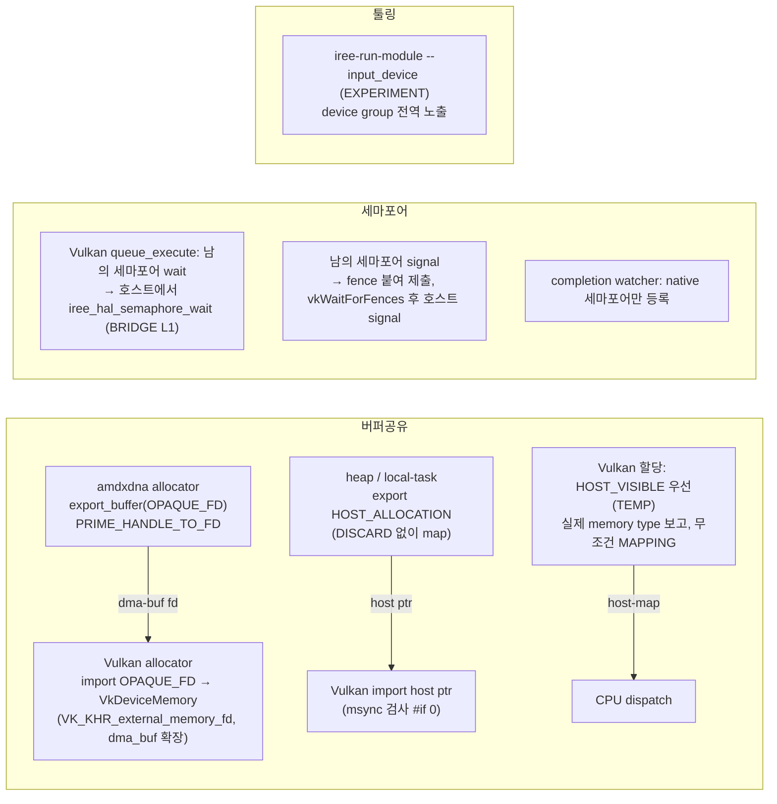

# S9. 전임자 런타임: 장치 간 버퍼 공유·세마포어 중개·입력 재배치 (런타임 수정, **우리는 검증만**)

- 구분: **전임자 코드(9/28 기준선)**. 우리는 이 위에 S2·S3·S4·S5를 얹었고, 이 코드 자체는 고치지 않았다. 다만 S3이 dispatch BRIDGE 본문을 옮겨 바꿨다.
- 장부 ID: amdxdna Pp12~17·Pp46~48(dma-buf export), Pp43(hwctx 캐시) / Vulkan Pi13~14(dispatch BRIDGE, 지금은 S3으로 대체), Pi10(memory type), Pi21~33·Pi37~40(dma-buf import·확장·memory type 보고), Pi15~20·Pi41~42(세마포어 BRIDGE L1) / Pi04(heap export) / Pi46~49·Pi55~57(`--input_device`, device group)
- 이유 문서: `docs/2026-09-28/01_인수인계_코드현황_파악/README.md` 3-2·3-4·3-5(전임자 설명은 없고, 우리가 코드로 추정한 목적), `docs/2026-09-28/08_Vulkan_copy_buffer_BRIDGE_조사/README.md`, 세마포어 구조 `docs/2026-10-19/3_세마포어_Host중개_조사/01_현재_동기화_구조/README.md`

## 1. 흐름상 위치

모두 런타임 HAL이다. 컴파일러가 정한 소유자(S8)·복사 제거(S1)가 실행될 수 있게 하는 **수단**이다.

## 2. 입력 → 동작 → 출력 (구성 요소별)

| 구성 요소 | 위치(현재 작업 트리) | 입력 → 동작 → 출력 |
|---|---|---|
| amdxdna dma-buf export | `runtime/src/iree-amd-aie/driver/amdxdna/allocator.cc:18-37`(`export_buffer`), `native_linux_kmq.cc`(`native_buffer_export_fd`: `DRM_IOCTL_PRIME_HANDLE_TO_FD` + `F_DUPFD_CLOEXEC`), 호환성에 `EXPORTABLE` | 버퍼 + 요청 타입 → OPAQUE_FD만 지원(그 외 `UNAVAILABLE`) → 새 fd |
| amdxdna hwctx 캐시 | `amdxdna/direct_command_buffer.cc:~1000-1024` | 환경 변수 `IREE_AMDXDNA_CACHE_HWCTX`가 있을 때만 (PDI, kernel) 키로 hw context 재사용. **기본 꺼짐** |
| Vulkan dma-buf import | `vulkan/native_allocator.cc:831-~915`(`import_opaque_fd_buffer` → `import_device_buffer`), `vulkan_device.cc`(확장 활성화), `extensibility_util.*`, `dynamic_symbol_tables.h`(`vkGetMemoryFdPropertiesKHR` OPTIONAL) | fd → `vkGetMemoryFdPropertiesKHR`로 가능한 memory type 확인 → `vkAllocateMemory`(import) → VkBuffer로 감싼 HAL 버퍼 |
| Vulkan memory type 선택 | `vulkan/base_buffer.c:137-160`(`TEMP: experiment`) | dispatch용 메모리 타입 고를 때 HOST_VISIBLE을 우선(없으면 원래 "비트 최소" 규칙) |
| Vulkan 실제 memory type 보고 | `vulkan/native_allocator.cc:294-325` | 할당된 타입의 HOST_VISIBLE/COHERENT/CACHED 비트를 HAL 버퍼 타입에 반영, VISIBLE+COHERENT면 MAPPING_PERSISTENT 추가 |
| 무조건 MAPPING | `vulkan/native_allocator.cc:198-207` | `query_buffer_compatibility`에서 `params->usage \|= MAPPING`(UMA 전제) |
| host ptr import 검사 끔 | `vulkan/native_allocator.cc:666` `#if 0 &&` | Mesa 버그(mesa#9251) 회피용 msync 사전 검사를 끔 |
| heap export | `runtime/src/iree/hal/allocator_heap.c:275-287` | export할 때 map 접근에서 DISCARD를 뺌(debug 빌드 0xCD 덮어쓰기 방지) |
| 세마포어 wait-foreign | `vulkan/direct_command_queue.cc:50-62` | `queue_execute`의 wait 목록에 Vulkan 세마포어가 아닌 것이 있으면 **VM 스레드가 호스트에서 `iree_hal_semaphore_wait`**, Vulkan 세마포어만 제출 wait 목록에 남김 |
| 세마포어 signal-foreign | `vulkan/direct_command_queue.cc:143-195` | signal 목록에 남의 세마포어가 있으면 fence를 붙여 제출하고 **`vkWaitForFences(UINT64_MAX)` 후 호스트에서 signal** |
| watcher 필터 | `vulkan/vulkan_device.cc:1939-1974` | completion watcher에 native 세마포어만 등록(최대 16개) |
| `--input_device` | `tooling/run_module.c`(EXPERIMENT), `context_util.c/.h`(device group 전역) | 인덱스(`--device` 순서) 목록 → 대상 장치 allocator에 동기 할당 + memcpy. 9/29부터 reflection 경로(S5)가 덧붙음 |
| 로그 | 여러 곳 | `[T]`/`[DBG]`/`[BR]` — 장부 4절 D1~D3 |

동기화 쌍별 동작(어느 쪽이 호스트에서 막는지)은 경계버퍼_전수표_동기화.md(세션 문서 `docs/2026-10-20/1_변경장부_명세_커밋준비/02_구현_명세/경계버퍼_전수표_동기화.md`, 팀 git 미포함) 2절.

## 3. 지원 범위와 지원하지 않는 경우

| 경우 | 동작 |
|---|---|
| amdxdna가 남의 버퍼를 import | **없음**(→ 표의 NPU→CPU·NPU→GPU false) |
| Vulkan이 남에게 export | 없음 |
| 남의 세마포어를 Vulkan 장치에서 직접 기다림(timeline import) | 없음. 세 드라이버 모두 `import/export_timepoint`가 UNIMPLEMENTED(10/19 세션 3). 그래서 호스트가 중개한다 |
| GPU가 남을 기다림 | VM 스레드가 호스트에서 막힌다(겹침 실행 이득 없음, 전임자 노트) |
| watcher에 남의 세마포어 | 등록하지 않음(이미 호스트가 처리) |
| 외장 GPU(dispatch 메모리가 host-visible 아님) | 무조건 MAPPING·HOST_VISIBLE 우선 전제가 깨진다 → **미지원** |
| Mesa import 버그가 있는 드라이버 | msync 검사를 껐으므로 잘못 성공한 import를 걸러내지 못할 수 있다(미시험) |
| fd 소유권 | import 주석은 "드라이버가 dup하므로 소유권은 호출자"라고 적었지만, Vulkan 규격은 fd import가 소유권을 구현으로 넘긴다고 정한다. 둘이 다르다. 7절 L-fd: 성공 경로는 규격대로(아무도 닫지 않음, 확인함), 실패 경로는 fd 누수(추정)(S3에도 기록) |

## 4. 추가 목적 / 기존 대비 변경점 (전임자 목적, 9/28 01에서 코드로 추정)

- 업스트림 IREE는 장치 간 버퍼를 **복사**(staging)로 넘기고, 세마포어도 같은 드라이버끼리만 직접 기다린다. 전임자 수정은 NPU·CPU·GPU가 같은 물리 메모리(UMA)를 **복사 없이** 공유하고, 서로 다른 드라이버의 세마포어를 **호스트가 중개**하게 한다.
- 9/7 발표 "세마포어 브릿지"가 이 L1 BRIDGE다. 같은 날 피드백 ②("세마포어 전달 구조 분석, Host가 중간에 각 장치에 맞게 처리해 줄 수 있을지")로 이어졌고, 10/19 세션 3 판정은 **부분 충족**이다(1-3).

## 5. 일반성 점검

| 항목 | 의존 | 이유·상태 |
|---|---|---|
| 무조건 MAPPING, HOST_VISIBLE 우선(TEMP), msync `#if 0` | **플랫폼(UMA, Radeon 890M)** | 근거 문서 없음(전임자 설명 없음). 통합 컴파일러 기준으로는 플랫폼 질의(메모리 타입이 실제로 host-visible인지)로 바꿔야 한다 |
| amdxdna export OPAQUE_FD만 | 드라이버 | dma-buf가 유일한 공유 경로 |
| 세마포어 중개 | 장치 이름 의존 없음(vtable 판정) | 호스트 차단 방식 |
| `--input_device` 인덱스 | `--device` 순서 | 툴링 실험 플래그. S5가 장치 ID 기반 자동 경로를 더함 |
| `vulkan-spirv` Accelerator TEMP | 백엔드 이름(S8) | 로드맵 3단계 |

## 6. 검증 근거 (우리가 한 것)

- 9/28 챕터 02: 회귀 기준선 재현(6개) — 이 경로 전체가 쓰인다.
- 9/28 챕터 08: Vulkan copy_buffer에 BRIDGE가 없는 문제 원인 확정 → S3.
- 9/28 챕터 07·10: amdxdna 동기 할당 placement NULL → S2.
- 10/2 세션 3: Vulkan map 겹침 → S4.
- 10/19 세션 3: 세마포어 경로 지도와 281회 시험(오답·순서 위반 0).
- 현재 회귀 26×2 PASS, VGG16 f32 3장치 NPU9/GPU4/CPU46 정확(10/18, 10/20 T5 5회 비트 동일).

## 7. 알려진 한계 (2026-10-20 CP1 결정: 명세에 남기고, 고칠지는 별도 결정)

| # | 한계 | 확인 | 영향 | 고치는 방향(미결정) |
|---|---|---|---|---|
| L-fd | **dma-buf fd 소유권**: amdxdna `export_fd`는 명령마다 `F_DUPFD_CLOEXEC`로 새 fd를 만들어 Vulkan import(`native_allocator.cc:843-` `import_opaque_fd_buffer`)에 넘긴다. 전임자 주석은 "The driver dups the fd during import, so ownership stays with the caller"라고 적었지만, Vulkan 규격(VK_KHR_external_memory_fd)은 **import가 성공하면 fd 소유권이 구현으로 넘어간다**고 정한다(실패하면 앱이 계속 소유). | 확인함(grep): BRIDGE·import 경로에 `close()`가 없다. 유일한 `close`는 테스트 훅(`amdxdna/allocator.cc:176`, `IREE_AMDXDNA_TEST_EXPORT`). → **성공 경로는 규격과 맞게 동작한다**(호출자가 닫지 않음). 주석만 틀렸다. **실패 경로**(`vkGetMemoryFdPropertiesKHR`·memory type 찾기·`vkAllocateMemory` 실패)에서는 fd를 아무도 닫지 않아 **샌다**(코드로 추정, 실행 미검증) | 성공 경로 영향 없음. 실패는 지금 에러로 멈추므로(S3) 새는 fd는 실행당 1개 수준 | (a) 주석을 규격대로 고치고 실패 경로에서 `close` (b) import 캐시와 함께 fd 수명 관리 (c) 긴 실행에서 `/proc/<pid>/fd` 개수 확인 |
